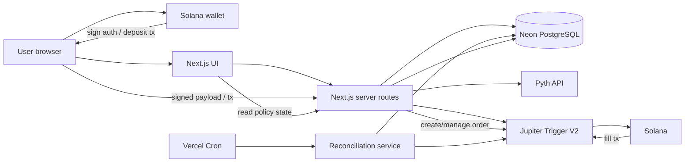

# CIRCUIT_ARCHITECTURE.md

> **Audience:** AI coding agents first, human maintainer second.  
> **Status:** Technical source of truth for the STOCKLANA MVP.  
> **Rule:** If implementation convenience conflicts with this file, this file wins until deliberately changed.  
> **Product source of truth:** `CIRCUIT_PRODUCT_BRIEF.md`.

Circuit is a policy-controlled tokenized-stock execution application on Solana. A connected wallet defines a bounded execution policy. Circuit validates the stock token and Pyth equity reference, compiles the policy to a Jupiter Trigger V2 order, guides the user through the required authorization/deposit flow, persists the policy/order relationship, and reconciles the provider's order state into a clear audit trail.

The architecture is deliberately small. We are not writing a custom Solana program, keeper network, DEX router, oracle, wallet, or custody system for the hackathon.

---

## 1. Architectural goals

The MVP must prove this end-to-end slice:

```text
connect wallet
→ select verified tokenized stock
→ fetch Pyth reference
→ define policy
→ compile policy
→ review exact authority
→ authorize Jupiter Trigger order
→ persist provider order
→ order remains active without browser
→ reconcile fill/cancel/expiry
→ show onchain evidence
```

Everything else is secondary.

### Non-goals

Do not add:

- custom Anchor program;
- custom Solana keeper;
- private-key custody;
- custom swap router;
- custom oracle aggregation;
- Redis;
- Kafka;
- queues;
- microservices;
- GraphQL;
- tRPC;
- Elasticsearch;
- WebSocket infrastructure owned by Circuit;
- generalized strategy scripting language;
- LLM in the executable policy path;
- multi-chain support;
- portfolio optimization;
- social features.

A requirement must force new infrastructure before it is introduced.

---

## 2. Stack

| Concern | Decision | Reason |
|---|---|---|
| Language | TypeScript 5.x, strict mode | Shared types across UI/server and strong AI-agent ecosystem support. |
| Runtime | Node.js 22 LTS | Stable server runtime with mature Solana/HTTP tooling. |
| Web framework | Next.js 16, App Router | One deployable web app for UI + server routes; no separate API service. |
| UI | React 19 | Native Next.js stack. |
| Styling | Tailwind CSS 4 | Fast product UI iteration without introducing a large design-system dependency. |
| Component primitives | Radix UI only where accessibility primitives are needed | Keep the dependency surface small. |
| Database | PostgreSQL on Neon (the provisioned project runs PostgreSQL 18) | Relational state fits policies/orders/events; managed and quick to provision. The schema uses only standard PostgreSQL features (identity columns, `gen_random_uuid()`, partial indexes, PL/pgSQL triggers), so it does not depend on a specific minor or patch release. |
| Query layer | Drizzle ORM | Explicit SQL-shaped schema/migrations without hiding database behavior. |
| Validation | Zod 4 | One validation layer at every external boundary. |
| Wallet | Solana Wallet Standard / compatible adapter | Do not invent custody. |
| Solana client | Official Solana JS client used by selected wallet integration | Required for addresses/signatures/transactions only. |
| Execution | Jupiter Trigger V2 API | Existing vault + keeper + autonomous execution infrastructure. |
| Reference data | Pyth Pro/Pyth equity feeds, server-side | Independent equity price/freshness layer; key never reaches client. |
| Testing | Vitest + Testing Library + Playwright | Domain/service tests plus one browser-level critical path. |
| Hosting | Vercel | Fast Next.js deployment and previews. |
| Background sync | Vercel Cron, once/minute, reconciliation only | Execution is owned by Jupiter; cron only mirrors external state locally. |
| Observability | Structured console logs + Vercel logs | Sufficient for hackathon scale. |
| Analytics | None in MVP | Not core to the demo. |

`package.json` and the lockfile pin exact versions. Do not silently upgrade wallet, Solana, Jupiter, or Pyth dependencies during the build.

---

## 3. Why no custom Solana program

A custom program would only be justified if Circuit itself needed to enforce an execution condition onchain.

The MVP does not.

Jupiter Trigger V2 already provides autonomous keeper execution, vault-backed orders, USD trigger conditions, four trigger directions, expiry/lifecycle, slippage controls, routing, and fills.

Writing an Anchor program would add program design, audits, CPI integration, vault security, deployment, and upgrade-authority questions without improving the core proof.

**Rejected:** custom vault + keeper program.  
**Reason:** duplicates existing infrastructure and materially increases the chance of losing funds or missing the deadline.

If a sponsor track later requires an onchain program, revise this architecture deliberately.

---

## 4. System diagram



### Source-of-truth hierarchy

For policy lifecycle:

```text
Circuit DB
= source of truth for user intent and local audit history

Jupiter Trigger
= source of truth for external order lifecycle

Solana
= source of truth for final transaction settlement
```

Task 10 replaced `pyth_reference_usd`, `pyth_feed_timestamp` and `pyth_snapshot_json` with the generic columns above (migrations `0006` add, `0007` drop; Neon had no policies). Pyth-specific detail (feed id, market session, carried-forward state) lives only inside a PYTH snapshot.

Mock mode (`CIRCUIT_JUPITER_MODE=mock`) is hackathon/demo infrastructure. Its simulated provider state (§5.8) stands in for Jupiter only in demos. It is never real Jupiter order truth and never Solana settlement truth, and everything it produces is labelled simulated.

For reference market data:

```text
Pyth
= source of truth for Circuit's recorded equity reference snapshot
```

Circuit must never invent a provider state.

---

## 5. Data model

All token quantities are stored as integer atomic units represented as PostgreSQL `numeric(78,0)` or decimal strings in TypeScript.

Never store token quantities in JavaScript floating point.

USD reference/trigger values are exact decimals.

All timestamps are UTC `timestamptz`.

Public application IDs are opaque UUIDs; never expose sequential IDs.

### 5.1 `wallets`

```text
id                  uuid PK
address             text UNIQUE NOT NULL
created_at          timestamptz NOT NULL
last_seen_at        timestamptz NOT NULL
```

No email/password accounts in MVP.

### 5.2 `assets`

Curated tokenized-stock catalog.

```text
id                  uuid PK
symbol              text NOT NULL
display_name        text NOT NULL
issuer              text NOT NULL
underlying_symbol   text NOT NULL
mint_address        text UNIQUE NOT NULL
decimals            smallint NOT NULL
reference_provider  enum PYTH | PRESTOCKS NOT NULL      (Task 10: which curated reference provider)
pyth_feed_id        text NULL                           (PYTH only; CHECK (reference_provider = 'PYTH') = (pyth_feed_id IS NOT NULL))
input_enabled       boolean NOT NULL default true
output_enabled      boolean NOT NULL default true
active              boolean NOT NULL default true
metadata            jsonb NOT NULL default '{}'
created_at          timestamptz NOT NULL
updated_at          timestamptz NOT NULL
```

Rules:

- users cannot submit arbitrary mint addresses in MVP;
- never map by ticker alone;
- verified mint is mandatory;
- a PRESTOCKS asset never gets a fake Pyth feed id; its reference configuration (exact contract address = mint, first-party API/product URLs) lives in `metadata.reference`.

### 5.3 `policies`

```text
id                         uuid PK
wallet_id                  uuid FK wallets.id NOT NULL
asset_id                   uuid FK assets.id NOT NULL

side                       enum BUY | SELL
trigger_direction          enum ABOVE | BELOW

source_expression_type     enum ABSOLUTE_PRICE | RELATIVE_PERCENT
source_expression_value    numeric NOT NULL

compiled_trigger_usd       numeric NOT NULL
amount_atomic              numeric(78,0) NOT NULL
input_mint                 text NOT NULL
output_mint                text NOT NULL
max_slippage_bps           integer NOT NULL

expires_at                 timestamptz NOT NULL

status                     enum
                           DRAFT
                           ARMING
                           ARMED
                           EXECUTED
                           CANCELLED
                           EXPIRED
                           FAILED

reference_provider         enum PYTH | PRESTOCKS NOT NULL
reference_usd              numeric NOT NULL      (captured reference: Pyth price, or PreStocks mark; exact source digits)
reference_timestamp        timestamptz NOT NULL  (provider source time when it exists (Pyth feedUpdateTimestamp);
                                                  PreStocks publishes none, so the time Circuit received the response)
reference_snapshot_json    jsonb NOT NULL        (provider-labelled snapshot; see §10)

provider                   text NOT NULL default 'jupiter_trigger_v2'
provider_order_id          text NULL
provider_state             enum NULL   PENDING | OPEN | EXECUTING | FILLED | PENDING_WITHDRAW | CANCELLED | EXPIRED | FAILED (live only, Task 9)
provider_state_updated_at  timestamptz NULL
provider_progress_json     jsonb NULL  provider-reported inputUsed / outputAmount / fillPercent (strings, never computed)

failure_code               text NULL
failure_message            text NULL

created_at                 timestamptz NOT NULL
armed_at                   timestamptz NULL
executed_at                timestamptz NULL
cancelled_at               timestamptz NULL
updated_at                 timestamptz NOT NULL
```

Indexes:

```text
(wallet_id, created_at desc)
(status, expires_at)
provider_order_id UNIQUE WHERE provider_order_id IS NOT NULL
```

Constraints:

- `amount_atomic > 0`;
- `max_slippage_bps` within configured range;
- `expires_at > created_at`;
- `compiled_trigger_usd > 0`;
- ARMED/terminal provider-backed policy must have `provider_order_id`.

### 5.4 `policy_events`

Append-only audit trail.

```text
id                  uuid PK
sequence_number     bigint GENERATED ALWAYS AS IDENTITY
policy_id           uuid FK policies.id NOT NULL
event_type          text NOT NULL
source              enum USER | CIRCUIT | JUPITER | SOLANA | SYSTEM | MOCK_PROVIDER
payload             jsonb NOT NULL
created_at          timestamptz NOT NULL default clock_timestamp()
```

Index:

```text
(policy_id, created_at asc)
```

Ordering: events are read in `(created_at asc, sequence_number asc)` order.

- `created_at` remains the event timestamp. It defaults to `clock_timestamp()` rather than `now()`, because `now()` is fixed for a whole transaction.
- `sequence_number` is assigned by the database on insert. It gives a deterministic order when timestamps tie, for example when several events are appended in one transaction.

Never rewrite ordinary event history. Append corrections. Database triggers reject `UPDATE`, `DELETE` and `TRUNCATE` on `policy_events`.

`MOCK_PROVIDER` is the source for events reported by the simulated provider, so they are never attributed to `JUPITER`.

### 5.5 `executions`

```text
id                      uuid PK
policy_id               uuid FK policies.id UNIQUE NOT NULL
provider_order_id       text NOT NULL
evidence_source         enum ONCHAIN | SIMULATED NOT NULL default ONCHAIN
transaction_signature   text NULL
input_amount_atomic     numeric(78,0) NOT NULL
output_amount_atomic    numeric(78,0) NULL
effective_price_usd     numeric NULL
fill_json               jsonb NOT NULL
executed_at             timestamptz NOT NULL
created_at              timestamptz NOT NULL
```

Evidence provenance, enforced by a CHECK constraint:

- `ONCHAIN`: `transaction_signature` and `output_amount_atomic` are required. Real settlement evidence.
- `SIMULATED`: both must be NULL. A simulated fill has no Solana transaction and no real output quantity, so Circuit records neither rather than fabricating them. `input_amount_atomic` is the policy's authorized amount, and `fill_json` says `simulated: true`.

If Jupiter exposes multiple partial fills, keep raw detail in `fill_json` for MVP and aggregate into one logical execution record.

Live Jupiter evidence (Task 9): a row is written only when Jupiter's order history reports the order `filled` with `inputUsed`, `outputAmount` and at least one successful `fill` event carrying a genuine 64-byte transaction signature. `input_amount_atomic`/`output_amount_atomic` are those exact provider strings. `transaction_signature` is the latest successful fill event's signature (never the deposit signature), and `fill_json.fills` holds every fill event: when an order filled in several transactions, `fill_json` is the complete evidence. `effective_price_usd` stays NULL (not derived).

Only introduce first-class `execution_fills` after confirming provider semantics demand it.

### 5.6 `wallet_auth_sessions`

Only if provider auth requires persisted JWT metadata.

```text
id                  uuid PK
wallet_id           uuid FK wallets.id NOT NULL
encrypted_jwt       text NULL
expires_at          timestamptz NOT NULL
created_at          timestamptz NOT NULL
updated_at          timestamptz NOT NULL
```

Rules:

- never store wallet private keys;
- provider JWT is a secret;
- encrypt if persisted;
- prefer ephemeral use if possible;
- expire aggressively.

This table is reserved for provider (Jupiter) auth. Circuit login does not use it.

**Not created (Task 8).** The Jupiter JWT is never persisted: it lives only in the HttpOnly `circuit_jupiter_session` cookie (§8, §11). There is no `wallet_auth_sessions` migration, and one should only be added if a server-side flow ever needs the JWT without a browser request, in which case it must be encrypted.

### 5.8 `mock_provider_orders` (demo infrastructure)

Durable state of the simulated execution provider, used only when `CIRCUIT_JUPITER_MODE=mock`. It stands in for the provider's own order records, so simulated orders survive reloads, browser closure and serverless restarts. It is never read as real Jupiter or Solana state, and it is removable once live execution is the only supported mode.

```text
id                  uuid PK
provider_order_id   text UNIQUE NOT NULL   -- always mock_<32 hex> (CHECK)
client_request_id   text UNIQUE NOT NULL   -- the arm idempotency key
policy_id           uuid FK policies.id UNIQUE NOT NULL
state               enum OPEN | FILLED | CANCELLED | EXPIRED | FAILED
expires_at          timestamptz NOT NULL
filled_at           timestamptz NULL
cancelled_at        timestamptz NULL
created_at          timestamptz NOT NULL
updated_at          timestamptz NOT NULL
```

Only the mock provider reads or writes this table. It never touches `policies`.

### 5.7 `auth_nonces`

Single-use Circuit login challenges (§8). A nonce stored only in a cookie cannot guarantee single use under concurrent or replayed verification on serverless infrastructure, so challenges are persisted.

```text
id                  uuid PK
nonce_hash          text UNIQUE NOT NULL      -- SHA-256 hex of the raw nonce; the raw nonce is never stored
wallet_address      text NOT NULL             -- the only wallet this challenge can authenticate
app_origin          text NOT NULL             -- origin embedded in the signed message (domain + URI)
cluster             text NOT NULL             -- Solana cluster embedded in the signed message
issued_at           timestamptz NOT NULL
expires_at          timestamptz NOT NULL      -- about 5 minutes after issued_at
consumed_at         timestamptz NULL
created_at          timestamptz NOT NULL
```

Index:

```text
(expires_at)
```

Rules:

- the server builds the canonical login message from these fields plus the raw nonce, and verifies the signature against exactly that message; it never accepts client-supplied message text;
- consume only after the Ed25519 signature verifies, with one conditional update (`consumed_at IS NULL AND expires_at > now AND wallet_address = signer`), so a nonce authenticates at most once;
- signatures are not stored;
- expired rows may be deleted; they carry no audit value.

### 5.9 `jupiter_deposit_preparations`

Pre-signing state for a live Jupiter Trigger deposit (Task 8, migration `0004`). Jupiter's `POST /deposit/craft` returns an UNSIGNED transaction and a **single-use `requestId`** that the later `POST /orders/price` must present with the signed deposit. If the requestId were lost after the wallet signed, the deposit could not be tied to an order, so it is committed **before** the unsigned transaction is returned to the browser.

```text
id                    uuid PK
policy_id             uuid FK policies.id NOT NULL
wallet_id             uuid FK wallets.id NOT NULL
status                enum PREPARING | CRAFTED | CONSUMED | INVALIDATED
deposit_request_id    text UNIQUE NULL          -- Jupiter's single-use requestId (set on CRAFTED)
unsigned_transaction  text NULL                 -- base64 UNSIGNED deposit tx, exactly as crafted
receiver_address      text NULL                 -- Jupiter vault receiving the deposit
input_mint            text NOT NULL
output_mint           text NOT NULL
input_amount_atomic   numeric(78,0) NOT NULL    -- CHECK > 0
created_at            timestamptz NOT NULL
updated_at            timestamptz NOT NULL
```

Constraints:

```text
UNIQUE (policy_id) WHERE status IN ('PREPARING', 'CRAFTED')    -- at most one active preparation per policy
CHECK status NOT IN ('CRAFTED', 'CONSUMED') OR (deposit_request_id AND unsigned_transaction are NOT NULL)
```

Rules:

- `PREPARING` is a reservation row inserted before the provider call; the Jupiter HTTP call never runs inside a DB transaction;
- `PREPARING → CRAFTED` is a compare-and-set that stores the requestId and unsigned tx, committed before the API responds;
- a failed craft, or a `PREPARING` row older than 60 s (a crashed request), becomes `INVALIDATED`;
- `CONSUMED`: Jupiter confirmed an order for this requestId (`provider_order_id`, `consumed_at`);
- the JWT is never stored here.

Task 9 additions (migration `0005`):

```text
deposit_tx_signature   text UNIQUE NULL   -- public transaction id of the wallet-signed deposit (recovery anchor)
signed_transaction     text NULL          -- verified signed deposit, held ONLY while submission is unresolved
submission_started_at  timestamptz NULL   -- CHECK: set ⇒ deposit_tx_signature set
consumed_at            timestamptz NULL
provider_order_id      text NULL
```

- Submission is `CRAFTED` + `submission_started_at`: the deposit signature (and the verified signed transaction) is committed, together with `DRAFT → ARMING`, **before** `POST /orders/price`.
- `signed_transaction` exists only so the SAME signed deposit can be resubmitted after a Jupiter 401 or an ambiguous failure (Jupiter documents create retries with the same deposit as idempotent) without a second wallet signature. It is cleared on `CONSUMED`/`INVALIDATED` and never logged. This supersedes the Task 8 rule that no signed deposit is stored.
- Freshness: an unsubmitted `CRAFTED` preparation older than 30 s is invalidated and re-crafted (its blockhash would expire before landing). Once submission starts it is never re-crafted.

### 5.10 `jupiter_cancel_preparations`

Two-step cancellation / withdrawal state (Task 9, migration `0005`). Jupiter's cancel call stops fills and returns an UNSIGNED withdrawal transaction plus a `cancelRequestId`; the signed withdrawal is verified against exactly that before `confirm-cancel`.

```text
id                      uuid PK
policy_id               uuid FK policies.id NOT NULL
wallet_id               uuid FK wallets.id NOT NULL
provider_order_id       text NOT NULL
purpose                 enum CANCEL | WITHDRAW_EXPIRED
status                  enum PREPARED | SUBMITTING | CONFIRMED | INVALIDATED
cancel_request_id       text NOT NULL
unsigned_transaction    text NOT NULL      -- exactly as Jupiter returned it
withdrawal_tx_signature text NULL          -- tx id when the wallet is fee payer; else from Jupiter's confirm response
signed_transaction      text NULL          -- CHECK: required while SUBMITTING; cleared after
submission_started_at   timestamptz NULL
confirmed_at            timestamptz NULL
created_at, updated_at  timestamptz NOT NULL
```

`UNIQUE (policy_id) WHERE status IN ('PREPARED','SUBMITTING')`: one active withdrawal per policy. Initiating again re-crafts (documented idempotent) and invalidates the previous row.

---

## 6. Directory structure

No new top-level directory without editing this file.

```text
/
├── CIRCUIT_ARCHITECTURE.md
├── CIRCUIT_PRODUCT_BRIEF.md
├── README.md
├── package.json
├── pnpm-lock.yaml
├── next.config.ts
├── tsconfig.json
├── drizzle.config.ts
├── .env.example
│
├── app/
│   ├── layout.tsx
│   ├── page.tsx
│   ├── dashboard/page.tsx
│   ├── policies/
│   │   ├── new/page.tsx
│   │   └── [policyId]/page.tsx
│   ├── markets/page.tsx         (PreStocks catalog: mark, token price, premium/discount, support state)
│   └── api/
│       ├── _lib/http.ts              (shared JSON envelope + error mapping; not a route)
│       ├── assets/route.ts
│       ├── reference/[assetId]/route.ts
│       ├── policies/route.ts
│       ├── policies/[policyId]/route.ts
│       ├── policies/[policyId]/arm/route.ts
│       ├── policies/[policyId]/cancel/route.ts
│       ├── policies/[policyId]/reconcile/route.ts
│       ├── policies/[policyId]/mock/simulate-fill/route.ts   (mock mode only; NOT_FOUND in live)
│       ├── auth/nonce/route.ts
│       ├── auth/verify/route.ts
│       ├── auth/logout/route.ts
│       ├── _lib/jupiter-route.ts     (session wallet + Jupiter cookie preamble; clears the cookie on 401)
│       ├── jupiter/auth/challenge/route.ts
│       ├── jupiter/auth/verify/route.ts
│       ├── jupiter/auth/logout/route.ts
│       ├── jupiter/status/route.ts
│       ├── jupiter/vault/register/route.ts
│       ├── policies/[policyId]/jupiter/deposit/route.ts   (prepare only; never signs or submits)
│       ├── policies/[policyId]/jupiter/arm/route.ts       (verify signed deposit → create order)
│       ├── policies/[policyId]/jupiter/cancel/route.ts    (step 1: stop fills, unsigned withdrawal)
│       ├── policies/[policyId]/jupiter/confirm-cancel/route.ts (step 2: verify signed withdrawal → confirm)
│       └── cron/reconcile/route.ts
│
├── components/
│   ├── wallet/
│   ├── jupiter/        (live-mode Jupiter auth + vault panel)
│   ├── prestocks/      (mark / token price / premium-discount summary, disclosure)
│   ├── policy/live-order-panel.tsx (live prepare → review → sign; ARMING/ARMED/withdrawal states)
│   ├── policy/
│   ├── asset/
│   └── ui/
│
├── design/
│   ├── circuit_mockup.html
│   └── circuit_mockup_alt.html
│
├── src/
│   ├── domain/
│   │   ├── policy.ts
│   │   ├── money.ts
│   │   ├── asset.ts
│   │   ├── reference.ts   (provider-labelled reference snapshot types; Task 10)
│   │   └── errors.ts
│   │
│   ├── services/
│   │   ├── create-policy.ts
│   │   ├── compile-policy.ts
│   │   ├── arm-policy.ts
│   │   ├── cancel-policy.ts
│   │   ├── reconcile-policy.ts
│   │   ├── get-reference.ts
│   │   ├── list-assets.ts
│   │   ├── prestocks-markets.ts   (catalog rows + technical support state)
│   │   ├── policy-view.ts
│   │   ├── policy-lifecycle.ts
│   │   ├── simulate-provider-fill.ts   (mock mode only)
│   │   └── jupiter/
│   │       ├── auth.ts             (challenge, base64 → base58 signature, verify)
│   │       ├── vault.ts            (status, explicit registration)
│   │       ├── prepare-deposit.ts  (gated BUY deposit preparation; requestId durability)
│   │       ├── live-gates.ts       (shared live eligibility: BUY, Pyth, compatibility, reference basis, minimum)
│   │       ├── arm-live.ts         (signed-deposit verification, create order, ambiguity handling)
│   │       ├── live-orders.ts      (history lookup, order matching, fill evidence, state application)
│   │       ├── reconcile-live.ts   (history reconciliation, ARMING recovery, mode dispatch)
│   │       ├── cancel-live.ts      (two-step cancel / withdrawal)
│   │       └── errors.ts           (Jupiter failure → AppError, live-mode and JWT guards)
│   │
│   ├── integrations/
│   │   ├── prestocks/
│   │   │   ├── client.ts   (first-party catalog; exact JSON digits; no key)
│   │   │   ├── mapper.ts   (per-item validation, exact mint, premium/discount)
│   │   │   └── types.ts
│   │   ├── pyth/
│   │   │   ├── client.ts
│   │   │   ├── mapper.ts
│   │   │   └── types.ts
│   │   └── jupiter/
│   │       ├── client.ts     (HTTP: tokens, quote, auth, vault, deposit craft, create, history, cancel)
│   │       ├── signed-transaction.ts (exact-message + wallet-signature verification; never signs)
│   │       ├── trigger.ts    (pure Circuit → Trigger V2 mapping, provider constants)
│   │       ├── types.ts      (Circuit-owned provider contract)
│   │       ├── schemas.ts    (Zod DTOs for Trigger V2, Tokens V2, Swap quote)
│   │       ├── token-compat.ts (Trigger Token-2022 deposit restrictions, per side)
│   │       ├── provider.ts   (mode → provider; never live→mock fallback)
│   │       ├── live.ts       (refuses until the Trigger V2 adapter exists)
│   │       └── mock.ts       (simulated provider, demo only)
│   │
│   ├── db/
│   │   ├── client.ts
│   │   ├── schema.ts
│   │   ├── asset-rows.ts   (curated config → assets row; used by seed and tests)
│   │   ├── repositories/
│   │   │   ├── assets.ts
│   │   │   ├── wallets.ts
│   │   │   ├── policies.ts
│   │   │   ├── executions.ts
│   │   │   ├── auth-nonces.ts
│   │   │   ├── jupiter-deposit-preparations.ts
│   │   │   ├── jupiter-cancel-preparations.ts
│   │   │   └── mock-provider-orders.ts
│   │   └── migrations/
│   │
│   ├── auth/
│   │   ├── wallet-message.ts
│   │   ├── verify-wallet.ts
│   │   ├── session.ts
│   │   ├── session-token.ts
│   │   ├── jupiter-session.ts   (HttpOnly Jupiter JWT cookie, wallet-bound)
│   │   ├── login.ts
│   │   └── current-wallet.ts
│   │
│   ├── validation/
│   │   ├── policy.ts
│   │   └── api.ts
│   │
│   ├── config/
│   │   ├── env.ts
│   │   ├── reference.ts
│   │   ├── tokens.ts
│   │   ├── assets.ts       (curated execution assets: PYTH and PRESTOCKS)
│   │   └── prestocks.ts    (display-only discovery results, keyed by exact mint)
│   │
│   └── observability/
│       └── logger.ts
│
└── tests/
    ├── unit/
    ├── integration/
    ├── fixtures/
    └── e2e/
```

### Ownership rules

`app/api/**`
- HTTP parsing;
- auth;
- request validation;
- one service call;
- HTTP response mapping.
- **No business logic.**

`src/services/**`
- use cases;
- transaction boundaries;
- state transitions;
- orchestration of repositories + integrations.

`src/domain/**`
- pure policy rules;
- money conversions;
- state transition rules;
- no network/database imports.

`src/integrations/**`
- external API semantics only;
- vendor-specific names stop here.

`src/db/repositories/**`
- Drizzle reads/writes only;
- no Pyth/Jupiter calls.

`components/**`
- presentation/browser interaction;
- no server secrets.

`design/**`
- non-runtime visual reference prototypes only;
- not application code and not product data;
- illustrative prices, mints, balances, fills, signatures and other values inside are mock design content only;
- runtime code must never import, read, or treat values in `design/` as real market or provider data.

---

## 7. Dependency direction

```text
UI / route handlers
        ↓
services
        ↓
domain
   ↙         ↘
repositories integrations
```

Forbidden:

- domain importing database;
- domain importing Jupiter/Pyth;
- repository importing service;
- integration importing UI;
- route handler writing DB state directly;
- client component importing server-only provider clients.

---

## 8. Wallet identity and authorization

Circuit identity is the wallet address.

Flow:

```text
request nonce (persisted as a hash in `auth_nonces`, ~5 minute expiry)
→ wallet signs Circuit login message
→ server rebuilds the canonical message and verifies the Ed25519 signature
→ server atomically consumes the nonce and upserts the wallet
→ server issues HttpOnly Secure SameSite=Lax session cookie
```

The Circuit session is a stateless HMAC-SHA-256 signed cookie (`circuit_session`) holding only the wallet address, issued-at, and expiry. There is no sessions table, so logout clears the cookie and a token stays valid until it expires.

Do not use `localStorage` bearer tokens for Circuit auth.

Every policy query/mutation must enforce:

```text
policy.wallet_id == authenticated_wallet.id
```

Knowing a UUID is not authorization.

Jupiter authorization is separate. A Circuit session cookie never grants authority to move funds.

Three credentials, shown separately in the UI:

```text
CIRCUIT SIGN-IN   circuit_session cookie (Circuit HMAC, 8h)        proves wallet identity to Circuit
JUPITER AUTH      circuit_jupiter_session cookie (Jupiter JWT, ≤24h) Jupiter Trigger bearer token
JUPITER VAULT     provider-side Privy vault (per wallet)           where Trigger deposits sit
```

`circuit_jupiter_session` is HttpOnly, SameSite=Lax, Path=/, Secure except on HTTP localhost, and has Max-Age of at most 24 h. Its value is `<wallet>~<jwt>` and it is only honored for the matching Circuit session wallet. The JWT is never inside the Circuit session token, never in the database, API JSON, logs, `localStorage` or `sessionStorage`. Circuit logout and a new Circuit sign-in both clear it; `POST /api/jupiter/auth/logout` clears only it.

---

## 9. Policy compiler

`src/services/compile-policy.ts` orchestrates pure compiler helpers in `src/domain/policy.ts`.

Input:

```text
side
triggerDirection
expressionType
expressionValue
amount
maxSlippageBps
expiresAt
referenceSnapshot
```

Output:

```text
compiledTriggerUsd
orderFamily        (Circuit-internal: SINGLE_PRICE_TRIGGER)
triggerCondition   (Circuit-internal: AT_OR_BELOW | AT_OR_ABOVE)
inputMint
outputMint
inputAmountAtomic
slippageBps
expiresAt
```

`orderFamily` and `triggerCondition` are Circuit's own representation, not Jupiter wire fields. The Jupiter integration maps them to the documented Trigger V2 request.

BUY: input USDC → output stock token. SELL: input stock token → output USDC. The USDC mint is verified configuration (`src/config/tokens.ts`), never resolved by symbol.

Absolute:

```text
BUY BELOW $181
→ 181
```

Relative:

```text
Pyth = 200
BUY 3% BELOW
→ 194
```

Rules:

- **Absolute** prices are taken as entered (at most 2 decimals) and do not depend on the reference.
- **Relative** triggers compute `reference × (1 ∓ pct/100)` exactly (0 < pct < 100), then round to cents in the **stricter** direction: `BELOW` rounds down and `ABOVE` rounds up. Rounding never makes a trigger fire earlier than the user's expression.
- **Reference freshness:** `STALE` blocks every draft. `CARRIED` blocks relative triggers but allows absolute ones, with the carried snapshot recorded as such. `UNAVAILABLE` blocks every draft, because each policy persists a reference snapshot.
- **Token amounts** convert to atomic units without rounding. Excess precision is rejected.

No JavaScript floating point for compiled monetary values.

Compilation must be deterministic and heavily unit-tested.

---

## 10. Reference providers

Task 10 generalized the reference layer. The curated asset config (§27) names each asset's provider; a request can never choose it, and there is no fallback between providers. `getAssetReference` (`src/services/get-reference.ts`) switches on the provider and returns a provider-labelled snapshot (`src/domain/reference.ts`):

```text
common      provider · referenceType · priceUsd (exact) · freshness · timestampKind · sourceTimestamp · receivedTimestamp
PYTH        referenceType UNDERLYING_EQUITY · freshness FRESH|CARRIED|STALE · timestampKind SOURCE
            pyth: feedId, symbol, confidence, publisherCount, marketSession, feedUpdateTimestamp, ageMs, isCarriedForward
PRESTOCKS   referenceType MARK_PRICE · freshness CURRENT_RESPONSE · timestampKind RECEIVED · sourceTimestamp null
            prestocks: name, symbol, contractAddress, markPriceUsd, tokenPriceUsd?, premiumPercent?, productUrl, apiUrl
```

The compiler is unchanged: `compiledTriggerUsd` is compiled from `priceUsd` (absolute or relative, stricter-direction cents). Provider wording lives in presentation (e.g. "% from PreStocks mark").

### 10.1 PreStocks provider (Task 10)

Source: `GET https://prestocks.com/api/prestocks` (first-party, public, no key; verified 2026-09-24). Each item: `name, symbol, description, image, external_url, contract_address, markPrice, markValuation, tokenPrice, impliedValuation, supply`. No timestamps.

- **Mark vs token price.** PreStocks labels them "Mark Price" and "Token Price". The mark is PreStocks' benchmark value and Circuit's policy reference; the token price is the onchain token's market price. Circuit shows premium (+) / discount (−) = (token − mark) / mark × 100, exact decimal maths, 2 dp. The mark is not called an oracle and is not a redemption guarantee.
- **Precision.** Prices arrive as JSON numbers; the client keeps their exact source digits (Node 22 JSON source text, like Pyth). No JS number arithmetic. Display rounds to cents; the trigger compiles to cents; the snapshot stores the exact mark, so an old policy is reproducible without the live API.
- **Freshness.** No per-price timestamp exists, so none is invented: `CURRENT_RESPONSE` means a successful response Circuit just received (`receivedTimestamp`), not that the mark updated then. Relative triggers require a current response with a valid mark for the exact curated mint. A missing token price does not block compilation (only premium/discount becomes unavailable).
- **Identity.** Only first-party prestocks.com sources establish identity and the mint; the mint must equal `contract_address`. Jupiter may confirm execution compatibility but is not the identity authority. Never CoinGecko/CMC/token lists, never ticker-derived mints, never HTML scraping for prices (product pages are read only by the no-funds probe, for lifecycle notices).
- **Failure.** API unavailable → `REFERENCE_UNAVAILABLE`, no draft, nothing cached; existing policies render from their snapshot; `/markets` shows "Reference temporarily unavailable". One malformed item never invalidates the others.
- **Reference basis.** Same pattern as Pyth → AAPLx (§11): the mark is the reference; Jupiter monitors the PreStocks token's own USD price against the unchanged compiled target; the review discloses that the token may trade at a premium or discount to the mark. The mark is captured once at creation; live orders are never adjusted when the mark changes.

### 10.2 Pyth provider

All Pyth credentials stay server-side.

Use REST on demand for MVP. Do not own a permanent WebSocket stream unless the UI proves it needs one.

Transport: `POST {PYTH_BASE_URL}/v1/latest_price` with `Authorization: Bearer <PYTH_API_KEY>`, `parsed: true` and `formats: []`, on the channel configured per asset (at or above the feed's `min_channel`). There is no SDK. Payloads are validated with Zod, and int64/u64 fields keep their exact JSON digits.

Primary reference: each asset's reference is the Pyth feed for its **underlying equity** (e.g. `Equity.US.AAPL/USD`), not the tokenized stock's own market feed (e.g. `Crypto.AAPLX/USD`). Token-market feeds may be recorded as comparison-only metadata, and are never used for compilation.

Internal type (`src/integrations/pyth/mapper.ts`):

```text
EquityReference
- feedId, symbol
- priceUsd, confidenceUsd?, bestBidUsd?, bestAskUsd?   exact decimal strings (mantissa × 10^exponent)
- exponent, publisherCount?
- marketSession?            regular | preMarket | postMarket | overNight | closed
- feedUpdateTimestamp(+Us)  when this feed's price was generated
- providerTimestamp         the update's timestampUs
- receivedTimestamp, ageMs
- isCarriedForward
- freshness
```

Freshness labels, derived only from documented payload fields:

```text
UNAVAILABLE  feed absent, no price, missing exponent/timestamp, non-positive price,
             timestamp from the future, or a transport/entitlement/schema failure
CARRIED      feedUpdateTimestamp < timestampUs (generated in an earlier update), at any age
STALE        not carried, and received more than MAX_REFERENCE_AGE_MS after generation
FRESH        not carried, and within MAX_REFERENCE_AGE_MS
```

`marketSession` is context. It does not decide freshness.

A stale, carried or unavailable reference blocks relative-policy compilation.

Do not silently represent carried-forward equity data as live. Never cache or show a previous value as current when Pyth is unavailable.

`GET /api/reference/[assetId]` requires a Circuit session and resolves the feed from the stored asset only. It never accepts a feed or symbol from the client.

---

## 11. Jupiter integration

All Jupiter API keys stay server-side.

Provider DTOs never become DB/domain types.

Integration responsibilities, verified against Trigger V2 docs and OpenAPI 2.0.0 (beta) on 2026-09-23. Base URL `https://api.jup.ag/trigger/v2`, `x-api-key` header plus `Authorization: Bearer <JWT>`:

```text
getAuthChallenge         POST /auth/challenge        (type message|transaction; challenge TTL 5 min)
exchangeSignedChallenge  POST /auth/verify           (base58 signature → JWT, 24h TTL, no refresh)
resolveVault             GET  /vault                 (404 = none) · GET /vault/register creates a Privy vault
prepareDeposit           POST /deposit/craft         (orderType "price", orderSubType "single"; UNSIGNED tx + single-use requestId)
createPriceOrder         POST /orders/price          (depositRequestId + depositSignedTx; lands the deposit; returns { id, txSignature, depositConfirmed })
getOrder                 GET  /orders/history        (no get-by-id for price orders: page with state/mint filters and match id)
cancelOrder              POST /orders/price/cancel/{id} → wallet signs withdrawal → POST /orders/price/confirm-cancel/{id}
```

Corrections recorded in Task 7 (current docs are authoritative):

- **Custody:** deposits sit in a per-wallet **Privy-managed custodial vault** operated by Jupiter, not a program-derived order account. Circuit still never holds keys or funds, and every deposit and withdrawal is signed by the user's wallet.
- **Trigger price basis:** Jupiter evaluates `triggerPriceUsd` against the **trigger token's own USD price** (e.g. AAPLx), not Circuit's Pyth reference.
- **Minimums and bounds:** 10 USD minimum per order. `slippageBps` 0–10000; when omitted, Jupiter's default is RTSE or 2000 bps, so Circuit always sends it. `expiresAt` is required, in milliseconds.
- **Token-2022:** supported, but deposit mints with transfer-fee or transfer-hook extensions are rejected unless whitelisted. This is assessed per side, because the deposit mint is the policy's input.
- **Expired orders:** funds stay in the vault and are recovered with the same two-step cancel/withdraw flow.
- **Cancellation:** step 1 stops fills immediately (`pending_withdraw`). `cancelled` appears only after the signed withdrawal confirms.
- **States:** `orderState` is `pending | open | executing | filled | pending_withdraw | cancelled | expired | failed`. `pending`, `executing` and `pending_withdraw` are in progress: no Circuit transition.

Use exact current Trigger V2 docs when implementing. Do not invent fields from memory.

**Task 8: authentication, vault, deposit preparation (live mode only).**

```text
POST /api/jupiter/auth/challenge   session wallet → Jupiter challenge (type "message"), returned unchanged
                                   UI shows it → explicit "Sign Jupiter login" → wallet.signMessage
POST /api/jupiter/auth/verify      { signature: base64 } → base58 → Jupiter /auth/verify → JWT → HttpOnly cookie
POST /api/jupiter/auth/logout      clears only the Jupiter cookie
GET  /api/jupiter/status           { mode, authenticated, expired, vault } — never the JWT; GET /vault 404 → NOT_REGISTERED
POST /api/jupiter/vault/register   explicit user action only; GET /vault/register; 409 = existing vault (success)
POST /api/policies/[id]/jupiter/deposit   prepare only (see §5.9); never signs, submits or calls /orders/price
```

- The wallet is always the Circuit session wallet. The UI blocks when the connected wallet differs, and explains when the wallet cannot `signMessage`.
- Jupiter 401 → `PROVIDER_AUTH_REQUIRED`, the cookie is cleared, and the UI shows the expired/reconnect state. Gateway 403 (`{code,message}`) → `PROVIDER_UNAVAILABLE`; Trigger 403/400 → `PROVIDER_REJECTED`; timeouts/network/5xx/429/malformed → `PROVIDER_UNAVAILABLE` (retryable).
- Mock mode is unchanged: these routes refuse with `PROVIDER_UNAVAILABLE` and never call Jupiter; the panel is not rendered.
- **BUY only.** SELL is rejected before any craft: "Live AAPLx sell orders are not enabled because the token's transfer-hook deposit path has not been verified with Jupiter Trigger."
- **Deposit gates, in order:** live mode → JWT cookie → owned DRAFT, unexpired policy → BUY → active asset → `liveBuyDepositGate` (Pyth live check PASSED, Jupiter BUY side not restricted/failed, reference basis RESOLVED) → USDC → stock-token mints → ≥ 10 USD → the wallet's own vault exists (`GET /vault`) → crafted `receiverAddress` = that vault and the transaction's fee payer = the wallet. Missing or malformed evidence fails closed.
- Production state: AAPLx has `pythLiveCheck: NOT_ENTITLED`, so deposit preparation and live arming are blocked there.

**ScaledUiAmount correction (Task 9).** Task 8's "execution-price calibration" blocker assumed AAPLx's ScaledUiAmount multiplier might have to be applied to the USD trigger. It must not. Per the Solana Scaled UI Amount docs and the xStocks multiplier guide, the multiplier changes DISPLAYED token quantities only (UI amount = raw × multiplier); raw balances never change and raw amounts are used in transactions. Jupiter's AAPLx `usdPrice` is the scaled, per-displayed-token price (observed 2026-09-24: `usdPrice` 336.44 beside a separate `usdPricePrescaled` 337.54 = 336.44 × 1.00327, and underlying AAPL `stockData.price` 337.10). Circuit never computes `trigger = Pyth × multiplier`. Proper scaled-balance handling (raw atomic amounts, scaled display) is unchanged.

**Reference basis (`assets.metadata.referenceBasis`, replaces `executionPriceCalibration`).**

```text
Pyth Equity.US.AAPL/USD   independent policy reference; Circuit compiles the USD target from it
Circuit compiled target    sent to Jupiter UNCHANGED as triggerPriceUsd (triggerMapping: IDENTITY)
Jupiter AAPLx/USD          what Jupiter's trigger engine monitors (the token's secondary-market price)
```

AAPLx secondary-market prices are set by supply and demand (xStocks FAQ) and can trade at a premium or discount to AAPL. The live review discloses this. No basis-adjustment formula is invented, and no copy claims Pyth controls Jupiter's trigger. Gate code: `REFERENCE_BASIS_UNRESOLVED`.

**Task 9: live order lifecycle (live mode only; docs re-verified 2026-09-24, OpenAPI unchanged since Task 7).**

```text
DRAFT
→ POST /api/policies/[id]/jupiter/deposit        Step 1: prepare (unsigned tx + requestId committed)
→ live review (Pyth reference · Circuit target · Jupiter AAPLx/USD monitor · vault · expiry · slippage)
→ explicit "Authorize deposit & arm": wallet.signTransaction on the exact prepared VersionedTransaction
→ POST /api/policies/[id]/jupiter/arm             server verifies the signed tx (below)
→ one DB tx: deposit_tx_signature (+ transient signed tx) committed, DRAFT → ARMING, events
→ POST /orders/price (body from persisted policy/config/preparation only)
→ 200 + depositConfirmed + matching txSignature → provider_order_id, preparation CONSUMED, ARMING → ARMED
→ reconcile (GET /orders/history) → EXECUTED / EXPIRED / FAILED / CANCELLED
→ "Cancel & withdraw": POST /orders/price/cancel/{id} → explicit "Confirm withdrawal" signature
→ POST /orders/price/confirm-cancel/{id} → CANCELLED (or EXPIRED + FUNDS_WITHDRAWN)
```

- **Signed-transaction integrity** (`signed-transaction.ts`), for deposits and withdrawals: strict base64; both deserialize as `VersionedTransaction`; serialized MESSAGE bytes identical to the persisted unsigned transaction; the wallet is a required signer and its Ed25519 signature verifies over exactly those bytes; no other signature slot changed; the bytes re-serialize identically. Anything else is rejected before Jupiter is called. Circuit never signs and never logs transaction bodies.
- **Wallet consistency:** connected wallet = Circuit session wallet (UI) = Jupiter cookie wallet (cookie binding) = transaction signer (server). Jupiter also rejects `userPubkey` ≠ JWT wallet (403).
- **Create failure semantics:** timeout, network, 5xx, 429, malformed or a `duplicate deposit` 400 are AMBIGUOUS: the policy stays ARMING, the deposit signature is the recovery anchor, and Circuit never crafts another deposit or asks for another signature. Only documented pre-landing rejections (other 400s, 403) mark ARMING → FAILED and invalidate the preparation. A 401 clears the Jupiter cookie and keeps ARMING; after re-auth the same signed deposit is resubmitted (explicit action, at least 60 s after the previous attempt, after checking history first).
- **ARMING recovery** (read-only reconcile): search `state=active` and `state=past` history (paged, filtered by the stock mint) for an order whose `deposit` event `txSignature` equals `deposit_tx_signature` AND whose wallet, mints and `initialInputAmount` match. One match → record it (`PROVIDER_ORDER_RECOVERED`) and apply its state; zero → still pending; several → `PROVIDER_ORDER_AMBIGUOUS`, nothing guessed.
- **Provider state mapping** (`policyStatusForLiveProviderState`, the single live mapping): `pending` → ARMING; `open`, `executing` (incl. partial fills), `pending_withdraw` → ARMED with `provider_state` showing the detail; `filled` → EXECUTED; `cancelled` → CANCELLED; `expired` → EXPIRED; `failed` → FAILED; anything else → logged, unchanged. An ARMING order found already terminal passes through ARMED first (two recorded transitions). Terminal Circuit states never move (EXECUTED never becomes CANCELLED).
- **Partial fills:** stay ARMED + `provider_state = EXECUTING`; `provider_progress_json` shows Jupiter's `inputUsed`/`outputAmount`/`fillPercent` only. EXECUTED only on `filled` with complete evidence (see §5.5).
- **Expired orders:** funds remain in the vault. EXPIRED stays the policy state; the same two-step flow withdraws (`WITHDRAW_EXPIRED`), recorded as `FUNDS_WITHDRAWN` with `provider_state = CANCELLED`, never as a cancellation.
- **Cancellation:** step 1 refreshes history first (a fill wins: EXECUTED, no cancel); only `open`/`pending_withdraw`/`expired` orders are cancelled; `executing` is refused (retry later). CANCELLED only after confirm-cancel returns. Confirm timeout/5xx/401 → retry the same signed withdrawal; 400 → re-initiate for a fresh withdrawal.
- **JWT expiry mid-flow** never loses durable state: preparations, deposit signatures and signed withdrawals survive; the user reconnects Jupiter and continues.
- **Explorer links** only for genuine 64-byte signatures (deposit, fill, withdrawal): never for mock ids, provider UUIDs or missing values.
- **Provider contract:** the live flow does not fit `ExecutionProvider` (it needs the user's JWT, a wallet-signed deposit and a two-step withdrawal), so live policies use the Jupiter services above. The mock keeps `ExecutionProvider`; `live.ts` still refuses the generic arm/cancel actions, and routes dispatch by `policies.provider`. Reconciliation of live orders needs the user's Jupiter session (there is no server-held JWT), so cron cannot reconcile them.

Jupiter owns keeper execution. Circuit owns user policy, reference context, and local audit state.

**Provider contract** (`src/integrations/jupiter/types.ts`): Circuit-owned DTOs, not Jupiter wire types.

```text
createOrder(clientRequestId, mints, inputAmountAtomic, triggerUsd, triggerCondition, slippageBps, expiresAt)
getOrder(providerOrderId)
cancelOrder(providerOrderId)
```

Provider states are normalized to `OPEN | FILLED | CANCELLED | EXPIRED | FAILED`, and mapped in one place (`src/domain/policy.ts`) to `ARMED | EXECUTED | CANCELLED | EXPIRED | FAILED`. Unknown states are logged and never guessed at.

**Modes:**

- `mock` → the simulated provider (`jupiter_trigger_v2_mock`).
- `live` → the Jupiter adapter. Until that exists, live mode refuses every operation with `PROVIDER_UNAVAILABLE`.
- Live mode **never falls back to the mock**.
- A policy is only ever managed by the provider that armed it (`policies.provider`).

---

## 12. Key flow — create draft

```text
Browser
→ POST /api/policies
→ authenticate wallet
→ validate body
→ load curated asset
→ fetch Pyth reference
→ compile deterministic trigger
→ create DRAFT policy
→ append POLICY_CREATED (USER), REFERENCE_CAPTURED (CIRCUIT), POLICY_COMPILED (CIRCUIT) events
→ return policy
```

The request carries only the asset id and the user's choices. The server resolves the mints, decimals, feed and reference, and never accepts a client-supplied price or mint.

One DB transaction.

Route handler does not calculate prices.

---

## 13. Key flow — arm policy

```text
DRAFT
→ user clicks Arm
→ reload policy
→ verify ownership
→ reject expired/terminal
→ refresh Pyth reference for UI sanity
→ initialize Jupiter auth/vault/deposit/order flow
→ wallet signs required payload/transaction
→ submit provider request
→ provider returns order id
→ DB transaction:
     provider_order_id
     status = ARMED
     armed_at
     POLICY_ARMED event
```

Hard rule:

> **Never set ARMED before the provider confirms the order exists.**

Use an application idempotency key. Trigger V2 has no client-supplied request id: provider-side idempotency is the single-use deposit `requestId` (a create retry with the same deposit is idempotent, and reuse after success is rejected as a duplicate deposit). The live adapter must persist the deposit `requestId` against the arm attempt before requesting the wallet signature. Circuit uses `circuit_arm_<policyId>`: a policy is armed at most once, so the key is fixed per policy. Concurrent or retried arms resume the same ARMING attempt, and the provider returns the same order for the same key.

A definitive provider rejection moves ARMING → FAILED. An ambiguous failure (timeout or unavailable) stays ARMING, and a retry with the same key resolves it without creating a second order.

If provider succeeds and DB write fails, recovery must use provider idempotency/client request ID if supported.

Live (Task 9): the persisted deposit signature is the recovery key. See §11 "Task 9: live order lifecycle".

---

## 14. Key flow — reconciliation

Circuit does not execute the trade.

Reconciliation mirrors Jupiter state.

Triggers:

- policy page load;
- manual refresh;
- cron;
- cancel completion.

```text
load ARMED policy
→ get Jupiter order
→ normalize state
→ if unchanged: no write
→ if terminal/fill:
    validate provider order
    persist execution evidence
    append event
    transition policy
```

Unknown provider state:

```text
log
do not guess
leave current state
surface diagnostic
```

---

## 15. Key flow — cancel

```text
POST /api/policies/:id/cancel
→ authenticate
→ verify ownership
→ require ARMED
→ request Jupiter cancel/withdraw flow
→ wallet signs if required
→ provider confirms
→ mark CANCELLED
→ append event
```

Never show `CANCELLED` while the external order is still active.

Live (Task 9): cancellation is Jupiter's two-step flow: `POST /orders/price/cancel/{id}` (fills stop, `pending_withdraw`, unsigned withdrawal persisted in §5.10) → explicit wallet signature → `POST /orders/price/confirm-cancel/{id}` → CANCELLED. See §11.

If cancellation is pending, keep the true order state and expose pending cancellation separately.

If fill and cancel race, provider truth wins; a confirmed fill means `EXECUTED`.

---

## 16. API design

REST-style JSON.

Success:

```json
{
  "data": {},
  "requestId": "req_..."
}
```

Error:

```json
{
  "error": {
    "code": "REFERENCE_STALE",
    "message": "The equity reference is not fresh enough to compile a relative trigger.",
    "retryable": true
  },
  "requestId": "req_..."
}
```

Stable error codes:

```text
UNAUTHENTICATED
FORBIDDEN
NOT_FOUND
VALIDATION_ERROR
ASSET_DISABLED
REFERENCE_UNAVAILABLE
REFERENCE_STALE
PROVIDER_AUTH_REQUIRED
PROVIDER_REJECTED
PROVIDER_UNAVAILABLE
POLICY_STATE_CONFLICT
POLICY_EXPIRED
ORDER_NOT_FOUND
CANCELLATION_FAILED
INTERNAL_ERROR
```

Policy lists use cursor pagination, not offsets.

---

## 17. State transitions

Allowed:

```text
DRAFT -> ARMING
ARMING -> ARMED
ARMING -> FAILED
ARMED -> EXECUTED
ARMED -> CANCELLED
ARMED -> EXPIRED
ARMED -> FAILED
DRAFT -> CANCELLED
```

Forbidden:

```text
EXECUTED -> ARMED
CANCELLED -> EXECUTED
EXPIRED -> ARMED
```

State transition logic lives in domain code and is unit-tested.

---

## 18. Money and decimal handling

### Token amounts

Use atomic integer units.

```text
100 USDC
6 decimals
= 100000000 atomic units
```

Use `bigint` internally or validated digit strings at JSON boundaries.

### USD values

Use exact decimals / fixed-scale integer math.

Never:

```ts
const trigger = 200 * 0.97
```

for money-critical compilation.

### Slippage

Store basis points.

```text
0.50% = 50 bps
```

---

## 19. Configuration

All environment access goes through `src/config/env.ts`.

Required:

```text
DATABASE_URL
CIRCUIT_SESSION_SECRET
CIRCUIT_TOKEN_ENCRYPTION_KEY
JUPITER_API_KEY
PYTH_API_KEY
CRON_SECRET
NEXT_PUBLIC_SOLANA_CLUSTER
NEXT_PUBLIC_APP_URL
```

Optional explicit bases if libraries require them:

```text
JUPITER_TRIGGER_BASE_URL
PYTH_BASE_URL
```

Never expose a secret with `NEXT_PUBLIC_`.

---

## 20. Security baseline

### No private keys

Circuit never requests/stores:

- seed phrase;
- wallet private key;
- exported secret key.

Reject any MVP design that requires this.

### Wallet login

Signed login message includes app/domain, wallet, nonce, issued-at, expiry, chain, and purpose.

Nonce is single-use.

### External payloads

Validate/normalize Pyth and Jupiter responses before domain use.

### Logging

Never log:

- Jupiter JWT;
- session cookies;
- API keys;
- secret material.

Wallet addresses and transaction signatures may appear in structured logs when needed.

### Rate limiting

Rate-limit auth nonce creation and expensive provider-backed mutations if a simple managed limiter is available. Do not introduce Redis solely for hackathon traffic.

---

## 21. Observability

Every request gets `requestId`.

Example:

```json
{
  "event": "policy.armed",
  "requestId": "...",
  "policyId": "...",
  "wallet": "...",
  "providerOrderId": "...",
  "durationMs": 123
}
```

Minimum categories:

```text
auth.*
reference.*
policy.*
jupiter.*
reconcile.*
cron.*
```

---

## 22. UI state management

Use server state as the durable source.

Use React local state for forms/interactions.

Do not add Redux/Zustand unless a concrete interaction forces it.

Wallet state remains in the wallet provider.

The DB/provider, not browser state, owns durable truth.

---

## 23. Testing strategy

The highest-risk code is code that can:

- compile the wrong price;
- spend the wrong amount;
- reverse buy/sell;
- mis-map provider state;
- claim a fill that did not happen.

### Unit tests

Money:
- display ↔ atomic;
- decimals;
- boundary/invalid inputs.

Policy:
- absolute triggers;
- relative triggers;
- BUY/SELL × ABOVE/BELOW;
- slippage;
- expiry;
- state transitions.

Pyth mapper:
- exponent handling;
- timestamp parsing;
- carried-forward detection;
- stale/unavailable.

Jupiter mapper:
- provider states;
- fill normalization;
- unknown state.

### Service tests

Required:

- create policy;
- stale reference blocks relative compile;
- ownership enforced;
- arm not ARMED before provider success;
- idempotent arm;
- reconcile terminalizes once;
- cancel only after confirmation.

### Integration tests

Use isolated Postgres for migration, constraints, ownership, and concurrent reconciliation.

External APIs use fixtures by default.

One opt-in live provider test may run manually.

### E2E

Playwright:

```text
mock wallet/provider
→ create draft
→ review
→ arm
→ ARMED
→ mocked fill
→ reconcile
→ EXECUTED
```

Before submission, manually run the real provider flow.

---

## 24. Concurrency and idempotency

### Arm

Use application idempotency key plus row lock/compare-and-set.

Two simultaneous arm requests must not create two live orders.

### Reconcile

Conditional update from `ARMED`.

`executions.policy_id` is unique.

Repeated reconciliation is safe.

### Jupiter deposit preparation

Reservation, not a held transaction: insert a `PREPARING` row (partial unique index = one active per policy) → call `/deposit/craft` outside any DB transaction → compare-and-set to `CRAFTED` with the requestId, committed before responding. Concurrent callers receive the existing `CRAFTED` preparation or a retryable `POLICY_STATE_CONFLICT`; they never trigger a second craft. Verified with 5 simultaneous prepares → 1 craft, 1 active row.

### Live arm (Task 9)

The first submission is a compare-and-set on the CRAFTED preparation (`submission_started_at IS NULL`) in the same transaction as `DRAFT → ARMING`, so concurrent arms cannot both reach Jupiter (verified: 5 concurrent → 1 create). Resubmission of the same signed deposit requires the previous attempt to be older than 60 s.

### Cancel versus fill

A provider-confirmed fill outranks a locally requested cancellation.

---

## 25. Cron

Cron only keeps Circuit's local view current.

Once per minute:

```text
select ARMED policies
→ query provider
→ reconcile
```

If cron stops, Jupiter orders must still be able to execute.

That distinction should be visible in the technical demo.

---

## 26. Deployment

Production:

```text
Vercel
- Next.js app
- API routes
- cron

Neon
- PostgreSQL

External
- Pyth
- Jupiter
- Solana
```

Schema changes require committed Drizzle migrations.

No ad-hoc production schema changes.

---

## 27. Asset catalog workflow

**Curated execution assets vs discovery (Task 10).** The PreStocks API is discovery/reference data. A PreStocks product becomes an execution asset only when curated in `src/config/assets.ts` after passing: first-party identity, a valid Solana mint (exact contract address), Jupiter exact-mint recognition, a USDC route, and the BUY Trigger deposit rule. `pnpm db:seed` also re-checks that the live first-party catalog still lists that exact mint. `/markets` shows the whole catalog with a technical support state (`SUPPORTED`, `ROUTE_VERIFIED`, `UNVERIFIED`, `NOT_ELIGIBLE` for lifecycle notices such as SpaceX's public listing) from `src/config/prestocks.ts`, keyed by exact mint; none of those rows is executable. Tessera or other non-PreStocks pre-IPO tokens are out of scope. PRESTOCKS assets never require Pyth entitlement; PYTH assets never use PreStocks.


Adding an asset requires:

```text
display name
underlying symbol
issuer
verified Solana mint
decimals
Pyth feed id
execution support
```

Before enabling:

1. verify issuer source;
2. verify mint;
3. verify Pyth feed;
4. verify Jupiter Trigger compatibility;
5. run a tiny quote/order test if possible.

Do not auto-enable scraped assets.

Verified entries live in `src/config/assets.ts` with their sources. `pnpm db:seed` writes an entry only after a live check confirms the deployment's Pyth key can read its reference feed. Until Jupiter compatibility is verified, a seeded asset is `active` (browsable, with a reference) but has `input_enabled = output_enabled = false`.

---

## 28. Provider failure policy

### Pyth unavailable

- existing ARMED Jupiter orders remain untouched;
- dashboard shows reference unavailable;
- new relative policies cannot compile.

### Jupiter unavailable

- no local arm/cancel completion;
- existing external orders may still be active;
- do not infer state.

### Database unavailable

- do not create new provider orders if intent/idempotency cannot be durably recorded;
- existing Jupiter orders continue externally;
- reconcile after recovery.

---

## 29. Accessibility and UX rules

- keyboard-operable forms/dialogs;
- status never by color alone;
- hashes copyable;
- numeric inputs show units;
- trigger direction written in words;
- final review page states the policy in one plain-English sentence;
- explain every wallet signature before prompting it.

Never show a generic **Sign** button with no explanation.

---

## 30. Rules for AI coding agents

1. Read this file and `CIRCUIT_PRODUCT_BRIEF.md` before coding.
2. Do not add dependencies without explaining why current stack cannot satisfy the requirement.
3. Do not add a custom Solana program in MVP.
4. Do not put business logic in route handlers.
5. Do not call privileged Pyth/Jupiter APIs from client components.
6. Do not store private keys.
7. Do not use floating point for token amounts or compiled trigger prices.
8. Do not accept arbitrary token mints.
9. Do not mark `ARMED`, `EXECUTED`, or `CANCELLED` before the external source confirms it.
10. Do not duplicate provider-state mappings.
11. Do not bypass wallet ownership checks.
12. Every schema change gets a migration.
13. Every external payload is normalized in its integration module.
14. Every policy behavior change gets unit tests.
15. Follow an existing pattern before adding a new abstraction.
16. No unrelated refactor inside a milestone.
17. Keep commits milestone-scoped.
18. Before declaring a milestone complete run typecheck, lint, tests, build, and `git diff --check`.
19. Update this file in the same commit if architecture changes.
20. Never exaggerate sponsor integration or execution guarantees in README/demo copy.

---

## 31. Decision log

### D-001 — Jupiter Trigger V2 is the execution rail
**Context:** Circuit needs execution after browser closure.  
**Choice:** compile policies into Jupiter Trigger V2.  
**Rejected:** our own keeper/vault/program.

### D-002 — Pyth is the independent reference layer
**Context:** equity reference should be separate from execution venue.  
**Choice:** record Pyth price/freshness and use it for relative trigger compilation.  
**Rejected:** treat DEX price as the only market truth.

### D-003 — No discretionary AI in execution
**Context:** core promise is bounded user authority.  
**Choice:** deterministic compiler.  
**Rejected:** model chooses asset/size/price.

### D-004 — Curated asset catalog
**Context:** ticker collisions/fake assets are unacceptable.  
**Choice:** verified mint + feed mapping.  
**Rejected:** arbitrary user-entered mint.

### D-005 — Wallet identity
**Context:** Solana wallet is already required.  
**Choice:** signed wallet login + secure cookie.  
**Rejected:** email/password/OAuth.

### D-006 — PostgreSQL
**Context:** policy/order/event relationships and uniqueness constraints matter.  
**Choice:** managed relational DB.  
**Rejected:** browser-only state.

### D-007 — Cron reconciles, not executes
**Context:** keeper execution belongs to Jupiter.  
**Choice:** status sync only.  
**Rejected:** Circuit worker holding broad user authority.

### D-009 — PreStocks as a second reference provider (Task 10, final feature expansion)
**Context:** PreStocks sponsor bounty; private-company tokens have no Pyth equity feed.
**Choice:** provider-aware reference layer; PreStocks mark as reference, Jupiter Trigger on the PreStocks token as execution; one curated asset (ANTHROPIC), BUY only.
**Rejected:** a second product, a second compiler, seeding the whole catalog, fake Pyth mappings, cross-provider fallback.

### D-008 — No custom program
**Context:** no MVP requirement forces one.  
**Choice:** compose existing infrastructure.  
**Rejected:** Anchor novelty project.

---

## 32. Build order

Each milestone must leave the app runnable.

### Milestone 0 — skeleton + contracts

- Next.js app;
- strict TS;
- Tailwind;
- env validation;
- error model;
- logger;
- production deploy;
- source-of-truth docs.

**Done:** local and deployed app run; typecheck/lint/test/build pass.

### Milestone 1 — data model + wallet identity

- Drizzle schema/migration;
- wallet/assets/policies/events/executions;
- signed wallet login/session;
- seed one verified asset, disabled for execution until verified.

**Done:** authenticated wallet sees its dashboard and cannot access another wallet's policy.

### Milestone 2 — Pyth reference

- server client;
- feed mapping;
- freshness parser;
- reference API;
- asset cards.

**Done:** real supported asset shows reference + freshness; stale/carried fixtures pass.

### Milestone 3 — policy compiler

- draft form;
- absolute + relative policy;
- exact money math;
- review screen;
- state machine.

**Done:** tests cover BUY/SELL × ABOVE/BELOW; draft persists with reference snapshot.

### Milestone 4 — Jupiter provider adapter

Implement only the current documented Trigger V2 flow:

- auth;
- vault;
- deposit preparation;
- order creation;
- fixtures.

**Done:** development wallet can create a tiny trigger order manually.

### Milestone 5 — arm end-to-end

- connect policy to provider;
- idempotency;
- ARMING/ARMED;
- event history;
- provider order ID.

**Done:** one Circuit policy creates exactly one Jupiter order and survives browser reload/closure.

### Milestone 6 — reconcile + cancel

- provider state mapping;
- execution evidence;
- manual reconcile;
- cron;
- cancel;
- fill/cancel race handling.

**Done:** real provider evidence drives terminal state; retries are idempotent.

### Milestone 7 — polish

- dashboard;
- audit timeline;
- transaction links;
- plain-English summary;
- errors/loading/empty states;
- responsive/accessibility pass.

No new scope.

### Milestone 8 — real proof

- verify 2–4 assets;
- tiny live order(s);
- preserve signatures/evidence;
- full manual demo rehearsal.

**Done:** reviewer can reproduce the main flow.

### Milestone 9 — submission

- README;
- architecture diagram;
- screenshots;
- 3-minute pitch;
- optional technical walkthrough;
- live URL;
- GitHub cleanup;
- verify sponsor-track claims against actual implementation.

---

## 33. Assumptions and open questions

### Locked assumptions

- Circuit is user-directed, not advisory.
- Jupiter Trigger V2 is execution rail.
- Circuit stores no private keys.
- Pyth is used for reference/freshness and deterministic relative-trigger compilation.
- Wallet is user identity.
- Assets are curated.
- One web app + managed Postgres is sufficient.
- Autonomous execution must survive browser closure.

### Verify during implementation

1. Which stock-token mints are supported by Jupiter Trigger V2, not merely standard swaps?
2. Which have matching Pyth equity feeds with useful freshness/session data?
3. Exact Jupiter JWT lifetime and whether auth metadata must be persisted.
4. Exact partial-fill and terminal-state semantics.
5. Whether Clawpump requires direct Meteora/Clawpump integration beyond an agent-native stock product.
6. Whether the Pyth bounty requires Pro-specific usage beyond the implemented reference layer.

These can change asset selection or sponsor-track submission, but not the core architecture.

---

## 34. Final architecture test

Ask:

> If the Vercel app goes offline five minutes after I arm a policy, can the authorized order still execute?

The answer must be **yes** because Jupiter owns the keeper/execution lifecycle.

Then ask:

> When Circuit comes back online, can it reconstruct the truth instead of guessing?

The answer must also be **yes** because provider state and Solana evidence can be reconciled into Circuit's durable policy record.

That is the architecture.
