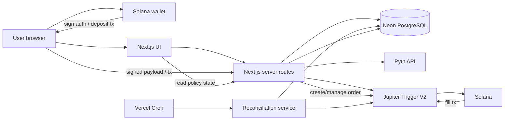

# CIRCUIT_ARCHITECTURE.md

> **Audience:** AI coding agents first, human maintainer second.  
> **Status:** Technical source of truth for the STOCKLANA MVP.  
> **Rule:** If implementation convenience conflicts with this file, this file wins until deliberately changed.  
> **Product source of truth:** `CIRCUIT_PRODUCT_BRIEF.md`.

Circuit is a policy-controlled tokenized-stock execution application on Solana. A connected wallet defines a bounded execution policy. Circuit validates the stock token and Pyth equity reference, compiles the policy to a Jupiter Trigger V2 order, guides the user through the required authorization/deposit flow, persists the policy/order relationship, and reconciles the provider's order state into a clear audit trail.

The architecture is deliberately small. We are not writing a custom Solana program, keeper network, DEX router, oracle, wallet, or custody system for the hackathon.

---

## 1. Architectural goals

The MVP must prove this end-to-end slice:

```text
connect wallet
→ select verified tokenized stock
→ fetch Pyth reference
→ define policy
→ compile policy
→ review exact authority
→ authorize Jupiter Trigger order
→ persist provider order
→ order remains active without browser
→ reconcile fill/cancel/expiry
→ show onchain evidence
```

Everything else is secondary.

### Non-goals

Do not add:

- custom Anchor program;
- custom Solana keeper;
- private-key custody;
- custom swap router;
- custom oracle aggregation;
- Redis;
- Kafka;
- queues;
- microservices;
- GraphQL;
- tRPC;
- Elasticsearch;
- WebSocket infrastructure owned by Circuit;
- generalized strategy scripting language;
- LLM in the executable policy path;
- multi-chain support;
- portfolio optimization;
- social features.

A requirement must force new infrastructure before it is introduced.

---

## 2. Stack

| Concern | Decision | Reason |
|---|---|---|
| Language | TypeScript 5.x, strict mode | Shared types across UI/server and strong AI-agent ecosystem support. |
| Runtime | Node.js 22 LTS | Stable server runtime with mature Solana/HTTP tooling. |
| Web framework | Next.js 16, App Router | One deployable web app for UI + server routes; no separate API service. |
| UI | React 19 | Native Next.js stack. |
| Styling | Tailwind CSS 4 | Fast product UI iteration without introducing a large design-system dependency. |
| Component primitives | Radix UI only where accessibility primitives are needed | Keep the dependency surface small. |
| Database | PostgreSQL on Neon (the provisioned project runs PostgreSQL 18) | Relational state fits policies/orders/events; managed and quick to provision. The schema uses only standard PostgreSQL features (identity columns, `gen_random_uuid()`, partial indexes, PL/pgSQL triggers), so it does not depend on a specific minor or patch release. |
| Query layer | Drizzle ORM | Explicit SQL-shaped schema/migrations without hiding database behavior. |
| Validation | Zod 4 | One validation layer at every external boundary. |
| Wallet | Solana Wallet Standard / compatible adapter | Do not invent custody. |
| Solana client | Official Solana JS client used by selected wallet integration | Required for addresses/signatures/transactions only. |
| Execution | Jupiter Trigger V2 API | Existing vault + keeper + autonomous execution infrastructure. |
| Reference data | Pyth Pro/Pyth equity feeds, server-side | Independent equity price/freshness layer; key never reaches client. |
| Testing | Vitest + Testing Library + Playwright | Domain/service tests plus one browser-level critical path. |
| Hosting | Vercel | Fast Next.js deployment and previews. |
| Background sync | Vercel Cron, once/minute, reconciliation only | Execution is owned by Jupiter; cron only mirrors external state locally. |
| Observability | Structured console logs + Vercel logs | Sufficient for hackathon scale. |
| Analytics | None in MVP | Not core to the demo. |

`package.json` and the lockfile pin exact versions. Do not silently upgrade wallet, Solana, Jupiter, or Pyth dependencies during the build.

---

## 3. Why no custom Solana program

A custom program would only be justified if Circuit itself needed to enforce an execution condition onchain.

The MVP does not.

Jupiter Trigger V2 already provides autonomous keeper execution, vault-backed orders, USD trigger conditions, four trigger directions, expiry/lifecycle, slippage controls, routing, and fills.

Writing an Anchor program would add program design, audits, CPI integration, vault security, deployment, and upgrade-authority questions without improving the core proof.

**Rejected:** custom vault + keeper program.  
**Reason:** duplicates existing infrastructure and materially increases the chance of losing funds or missing the deadline.

If a sponsor track later requires an onchain program, revise this architecture deliberately.

---

## 4. System diagram



### Source-of-truth hierarchy

For policy lifecycle:

```text
Circuit DB
= source of truth for user intent and local audit history

Jupiter Trigger
= source of truth for external order lifecycle

Solana
= source of truth for final transaction settlement
```

For reference market data:

```text
Pyth
= source of truth for Circuit's recorded equity reference snapshot
```

Circuit must never invent a provider state.

---

## 5. Data model

All token quantities are stored as integer atomic units represented as PostgreSQL `numeric(78,0)` or decimal strings in TypeScript.

Never store token quantities in JavaScript floating point.

USD reference/trigger values are exact decimals.

All timestamps are UTC `timestamptz`.

Public application IDs are opaque UUIDs; never expose sequential IDs.

### 5.1 `wallets`

```text
id                  uuid PK
address             text UNIQUE NOT NULL
created_at          timestamptz NOT NULL
last_seen_at        timestamptz NOT NULL
```

No email/password accounts in MVP.

### 5.2 `assets`

Curated tokenized-stock catalog.

```text
id                  uuid PK
symbol              text NOT NULL
display_name        text NOT NULL
issuer              text NOT NULL
underlying_symbol   text NOT NULL
mint_address        text UNIQUE NOT NULL
decimals            smallint NOT NULL
pyth_feed_id        text NOT NULL
input_enabled       boolean NOT NULL default true
output_enabled      boolean NOT NULL default true
active              boolean NOT NULL default true
metadata            jsonb NOT NULL default '{}'
created_at          timestamptz NOT NULL
updated_at          timestamptz NOT NULL
```

Rules:

- users cannot submit arbitrary mint addresses in MVP;
- never map by ticker alone;
- verified mint is mandatory.

### 5.3 `policies`

```text
id                         uuid PK
wallet_id                  uuid FK wallets.id NOT NULL
asset_id                   uuid FK assets.id NOT NULL

side                       enum BUY | SELL
trigger_direction          enum ABOVE | BELOW

source_expression_type     enum ABSOLUTE_PRICE | RELATIVE_PERCENT
source_expression_value    numeric NOT NULL

compiled_trigger_usd       numeric NOT NULL
amount_atomic              numeric(78,0) NOT NULL
input_mint                 text NOT NULL
output_mint                text NOT NULL
max_slippage_bps           integer NOT NULL

expires_at                 timestamptz NOT NULL

status                     enum
                           DRAFT
                           ARMING
                           ARMED
                           EXECUTED
                           CANCELLED
                           EXPIRED
                           FAILED

pyth_reference_usd         numeric NOT NULL
pyth_feed_timestamp        timestamptz NOT NULL
pyth_snapshot_json         jsonb NOT NULL

provider                   text NOT NULL default 'jupiter_trigger_v2'
provider_order_id          text NULL

failure_code               text NULL
failure_message            text NULL

created_at                 timestamptz NOT NULL
armed_at                   timestamptz NULL
executed_at                timestamptz NULL
cancelled_at               timestamptz NULL
updated_at                 timestamptz NOT NULL
```

Indexes:

```text
(wallet_id, created_at desc)
(status, expires_at)
provider_order_id UNIQUE WHERE provider_order_id IS NOT NULL
```

Constraints:

- `amount_atomic > 0`;
- `max_slippage_bps` within configured range;
- `expires_at > created_at`;
- `compiled_trigger_usd > 0`;
- ARMED/terminal provider-backed policy must have `provider_order_id`.

### 5.4 `policy_events`

Append-only audit trail.

```text
id                  uuid PK
sequence_number     bigint GENERATED ALWAYS AS IDENTITY
policy_id           uuid FK policies.id NOT NULL
event_type          text NOT NULL
source              enum USER | CIRCUIT | JUPITER | SOLANA | SYSTEM
payload             jsonb NOT NULL
created_at          timestamptz NOT NULL default clock_timestamp()
```

Index:

```text
(policy_id, created_at asc)
```

Ordering: events are read in `(created_at asc, sequence_number asc)` order.

- `created_at` remains the event timestamp. It defaults to `clock_timestamp()` rather than `now()`, because `now()` is fixed for a whole transaction.
- `sequence_number` is assigned by the database on insert. It gives a deterministic order when timestamps tie, for example when several events are appended in one transaction.

Never rewrite ordinary event history. Append corrections. Database triggers reject `UPDATE`, `DELETE` and `TRUNCATE` on `policy_events`.

### 5.5 `executions`

```text
id                      uuid PK
policy_id               uuid FK policies.id UNIQUE NOT NULL
provider_order_id       text NOT NULL
transaction_signature   text NOT NULL
input_amount_atomic     numeric(78,0) NOT NULL
output_amount_atomic    numeric(78,0) NOT NULL
effective_price_usd     numeric NULL
fill_json               jsonb NOT NULL
executed_at             timestamptz NOT NULL
created_at              timestamptz NOT NULL
```

If Jupiter exposes multiple partial fills, keep raw detail in `fill_json` for MVP and aggregate into one logical execution record.

Only introduce first-class `execution_fills` after confirming provider semantics demand it.

### 5.6 `wallet_auth_sessions`

Only if provider auth requires persisted JWT metadata.

```text
id                  uuid PK
wallet_id           uuid FK wallets.id NOT NULL
encrypted_jwt       text NULL
expires_at          timestamptz NOT NULL
created_at          timestamptz NOT NULL
updated_at          timestamptz NOT NULL
```

Rules:

- never store wallet private keys;
- provider JWT is a secret;
- encrypt if persisted;
- prefer ephemeral use if possible;
- expire aggressively.

This table is reserved for provider (Jupiter) auth. Circuit login does not use it.

### 5.7 `auth_nonces`

Single-use Circuit login challenges (§8). A nonce stored only in a cookie cannot guarantee single use under concurrent or replayed verification on serverless infrastructure, so challenges are persisted.

```text
id                  uuid PK
nonce_hash          text UNIQUE NOT NULL      -- SHA-256 hex of the raw nonce; the raw nonce is never stored
wallet_address      text NOT NULL             -- the only wallet this challenge can authenticate
app_origin          text NOT NULL             -- origin embedded in the signed message (domain + URI)
cluster             text NOT NULL             -- Solana cluster embedded in the signed message
issued_at           timestamptz NOT NULL
expires_at          timestamptz NOT NULL      -- about 5 minutes after issued_at
consumed_at         timestamptz NULL
created_at          timestamptz NOT NULL
```

Index:

```text
(expires_at)
```

Rules:

- the server builds the canonical login message from these fields plus the raw nonce, and verifies the signature against exactly that message; it never accepts client-supplied message text;
- consume only after the Ed25519 signature verifies, with one conditional update (`consumed_at IS NULL AND expires_at > now AND wallet_address = signer`), so a nonce authenticates at most once;
- signatures are not stored;
- expired rows may be deleted; they carry no audit value.

---

## 6. Directory structure

No new top-level directory without editing this file.

```text
/
├── CIRCUIT_ARCHITECTURE.md
├── CIRCUIT_PRODUCT_BRIEF.md
├── README.md
├── package.json
├── pnpm-lock.yaml
├── next.config.ts
├── tsconfig.json
├── drizzle.config.ts
├── .env.example
│
├── app/
│   ├── layout.tsx
│   ├── page.tsx
│   ├── dashboard/page.tsx
│   ├── policies/
│   │   ├── new/page.tsx
│   │   └── [policyId]/page.tsx
│   └── api/
│       ├── _lib/http.ts              (shared JSON envelope + error mapping; not a route)
│       ├── assets/route.ts
│       ├── reference/[assetId]/route.ts
│       ├── policies/route.ts
│       ├── policies/[policyId]/route.ts
│       ├── policies/[policyId]/arm/route.ts
│       ├── policies/[policyId]/cancel/route.ts
│       ├── policies/[policyId]/reconcile/route.ts
│       ├── auth/nonce/route.ts
│       ├── auth/verify/route.ts
│       ├── auth/logout/route.ts
│       ├── jupiter/auth/... 
│       └── cron/reconcile/route.ts
│
├── components/
│   ├── wallet/
│   ├── policy/
│   ├── asset/
│   └── ui/
│
├── design/
│   ├── circuit_mockup.html
│   └── circuit_mockup_alt.html
│
├── src/
│   ├── domain/
│   │   ├── policy.ts
│   │   ├── money.ts
│   │   ├── asset.ts
│   │   └── errors.ts
│   │
│   ├── services/
│   │   ├── create-policy.ts
│   │   ├── compile-policy.ts
│   │   ├── arm-policy.ts
│   │   ├── cancel-policy.ts
│   │   ├── reconcile-policy.ts
│   │   ├── get-reference.ts
│   │   ├── list-assets.ts
│   │   └── policy-view.ts
│   │
│   ├── integrations/
│   │   ├── pyth/
│   │   │   ├── client.ts
│   │   │   ├── mapper.ts
│   │   │   └── types.ts
│   │   └── jupiter/
│   │       ├── client.ts
│   │       ├── auth.ts
│   │       ├── trigger.ts
│   │       └── types.ts
│   │
│   ├── db/
│   │   ├── client.ts
│   │   ├── schema.ts
│   │   ├── repositories/
│   │   │   ├── assets.ts
│   │   │   ├── wallets.ts
│   │   │   ├── policies.ts
│   │   │   ├── executions.ts
│   │   │   └── auth-nonces.ts
│   │   └── migrations/
│   │
│   ├── auth/
│   │   ├── wallet-message.ts
│   │   ├── verify-wallet.ts
│   │   ├── session.ts
│   │   ├── session-token.ts
│   │   ├── login.ts
│   │   └── current-wallet.ts
│   │
│   ├── validation/
│   │   ├── policy.ts
│   │   └── api.ts
│   │
│   ├── config/
│   │   ├── env.ts
│   │   ├── reference.ts
│   │   ├── tokens.ts
│   │   └── assets.ts
│   │
│   └── observability/
│       └── logger.ts
│
└── tests/
    ├── unit/
    ├── integration/
    ├── fixtures/
    └── e2e/
```

### Ownership rules

`app/api/**`
- HTTP parsing;
- auth;
- request validation;
- one service call;
- HTTP response mapping.
- **No business logic.**

`src/services/**`
- use cases;
- transaction boundaries;
- state transitions;
- orchestration of repositories + integrations.

`src/domain/**`
- pure policy rules;
- money conversions;
- state transition rules;
- no network/database imports.

`src/integrations/**`
- external API semantics only;
- vendor-specific names stop here.

`src/db/repositories/**`
- Drizzle reads/writes only;
- no Pyth/Jupiter calls.

`components/**`
- presentation/browser interaction;
- no server secrets.

`design/**`
- non-runtime visual reference prototypes only;
- not application code and not product data;
- illustrative prices, mints, balances, fills, signatures and other values inside are mock design content only;
- runtime code must never import, read, or treat values in `design/` as real market or provider data.

---

## 7. Dependency direction

```text
UI / route handlers
        ↓
services
        ↓
domain
   ↙         ↘
repositories integrations
```

Forbidden:

- domain importing database;
- domain importing Jupiter/Pyth;
- repository importing service;
- integration importing UI;
- route handler writing DB state directly;
- client component importing server-only provider clients.

---

## 8. Wallet identity and authorization

Circuit identity is the wallet address.

Flow:

```text
request nonce (persisted as a hash in `auth_nonces`, ~5 minute expiry)
→ wallet signs Circuit login message
→ server rebuilds the canonical message and verifies the Ed25519 signature
→ server atomically consumes the nonce and upserts the wallet
→ server issues HttpOnly Secure SameSite=Lax session cookie
```

The Circuit session is a stateless HMAC-SHA-256 signed cookie (`circuit_session`) holding only the wallet address, issued-at, and expiry. There is no sessions table, so logout clears the cookie and a token stays valid until it expires.

Do not use `localStorage` bearer tokens for Circuit auth.

Every policy query/mutation must enforce:

```text
policy.wallet_id == authenticated_wallet.id
```

Knowing a UUID is not authorization.

Jupiter authorization is separate. A Circuit session cookie never grants authority to move funds.

---

## 9. Policy compiler

`src/services/compile-policy.ts` orchestrates pure compiler helpers in `src/domain/policy.ts`.

Input:

```text
side
triggerDirection
expressionType
expressionValue
amount
maxSlippageBps
expiresAt
referenceSnapshot
```

Output:

```text
compiledTriggerUsd
orderFamily        (Circuit-internal: SINGLE_PRICE_TRIGGER)
triggerCondition   (Circuit-internal: AT_OR_BELOW | AT_OR_ABOVE)
inputMint
outputMint
inputAmountAtomic
slippageBps
expiresAt
```

`orderFamily` and `triggerCondition` are Circuit's own representation, not Jupiter wire fields. The Jupiter integration maps them to the documented Trigger V2 request.

BUY: input USDC → output stock token. SELL: input stock token → output USDC. The USDC mint is verified configuration (`src/config/tokens.ts`), never resolved by symbol.

Absolute:

```text
BUY BELOW $181
→ 181
```

Relative:

```text
Pyth = 200
BUY 3% BELOW
→ 194
```

Rules:

- **Absolute** prices are taken as entered (at most 2 decimals) and do not depend on the reference.
- **Relative** triggers compute `reference × (1 ∓ pct/100)` exactly (0 < pct < 100), then round to cents in the **stricter** direction: `BELOW` rounds down and `ABOVE` rounds up. Rounding never makes a trigger fire earlier than the user's expression.
- **Reference freshness:** `STALE` blocks every draft. `CARRIED` blocks relative triggers but allows absolute ones, with the carried snapshot recorded as such. `UNAVAILABLE` blocks every draft, because each policy persists a reference snapshot.
- **Token amounts** convert to atomic units without rounding. Excess precision is rejected.

No JavaScript floating point for compiled monetary values.

Compilation must be deterministic and heavily unit-tested.

---

## 10. Pyth integration

All Pyth credentials stay server-side.

Use REST on demand for MVP. Do not own a permanent WebSocket stream unless the UI proves it needs one.

Transport: `POST {PYTH_BASE_URL}/v1/latest_price` with `Authorization: Bearer <PYTH_API_KEY>`, `parsed: true` and `formats: []`, on the channel configured per asset (at or above the feed's `min_channel`). There is no SDK. Payloads are validated with Zod, and int64/u64 fields keep their exact JSON digits.

Primary reference: each asset's reference is the Pyth feed for its **underlying equity** (e.g. `Equity.US.AAPL/USD`), not the tokenized stock's own market feed (e.g. `Crypto.AAPLX/USD`). Token-market feeds may be recorded as comparison-only metadata, and are never used for compilation.

Internal type (`src/integrations/pyth/mapper.ts`):

```text
EquityReference
- feedId, symbol
- priceUsd, confidenceUsd?, bestBidUsd?, bestAskUsd?   exact decimal strings (mantissa × 10^exponent)
- exponent, publisherCount?
- marketSession?            regular | preMarket | postMarket | overNight | closed
- feedUpdateTimestamp(+Us)  when this feed's price was generated
- providerTimestamp         the update's timestampUs
- receivedTimestamp, ageMs
- isCarriedForward
- freshness
```

Freshness labels, derived only from documented payload fields:

```text
UNAVAILABLE  feed absent, no price, missing exponent/timestamp, non-positive price,
             timestamp from the future, or a transport/entitlement/schema failure
CARRIED      feedUpdateTimestamp < timestampUs (generated in an earlier update), at any age
STALE        not carried, and received more than MAX_REFERENCE_AGE_MS after generation
FRESH        not carried, and within MAX_REFERENCE_AGE_MS
```

`marketSession` is context. It does not decide freshness.

A stale, carried or unavailable reference blocks relative-policy compilation.

Do not silently represent carried-forward equity data as live. Never cache or show a previous value as current when Pyth is unavailable.

`GET /api/reference/[assetId]` requires a Circuit session and resolves the feed from the stored asset only. It never accepts a feed or symbol from the client.

---

## 11. Jupiter integration

All Jupiter API keys stay server-side.

Provider DTOs never become DB/domain types.

Integration responsibilities:

```text
getAuthChallenge
exchangeSignedChallenge
resolveVault
prepareDeposit
createPriceOrder
getOrder
cancelOrder
```

Use exact current Trigger V2 docs when implementing. Do not invent fields from memory.

Jupiter owns keeper execution. Circuit owns user policy, reference context, and local audit state.

---

## 12. Key flow — create draft

```text
Browser
→ POST /api/policies
→ authenticate wallet
→ validate body
→ load curated asset
→ fetch Pyth reference
→ compile deterministic trigger
→ create DRAFT policy
→ append POLICY_CREATED (USER), REFERENCE_CAPTURED (CIRCUIT), POLICY_COMPILED (CIRCUIT) events
→ return policy
```

The request carries only the asset id and the user's choices. The server resolves the mints, decimals, feed and reference, and never accepts a client-supplied price or mint.

One DB transaction.

Route handler does not calculate prices.

---

## 13. Key flow — arm policy

```text
DRAFT
→ user clicks Arm
→ reload policy
→ verify ownership
→ reject expired/terminal
→ refresh Pyth reference for UI sanity
→ initialize Jupiter auth/vault/deposit/order flow
→ wallet signs required payload/transaction
→ submit provider request
→ provider returns order id
→ DB transaction:
     provider_order_id
     status = ARMED
     armed_at
     POLICY_ARMED event
```

Hard rule:

> **Never set ARMED before the provider confirms the order exists.**

Use an application idempotency key.

If provider succeeds and DB write fails, recovery must use provider idempotency/client request ID if supported.

---

## 14. Key flow — reconciliation

Circuit does not execute the trade.

Reconciliation mirrors Jupiter state.

Triggers:

- policy page load;
- manual refresh;
- cron;
- cancel completion.

```text
load ARMED policy
→ get Jupiter order
→ normalize state
→ if unchanged: no write
→ if terminal/fill:
    validate provider order
    persist execution evidence
    append event
    transition policy
```

Unknown provider state:

```text
log
do not guess
leave current state
surface diagnostic
```

---

## 15. Key flow — cancel

```text
POST /api/policies/:id/cancel
→ authenticate
→ verify ownership
→ require ARMED
→ request Jupiter cancel/withdraw flow
→ wallet signs if required
→ provider confirms
→ mark CANCELLED
→ append event
```

Never show `CANCELLED` while the external order is still active.

If cancellation is pending, keep the true order state and expose pending cancellation separately.

If fill and cancel race, provider truth wins; a confirmed fill means `EXECUTED`.

---

## 16. API design

REST-style JSON.

Success:

```json
{
  "data": {},
  "requestId": "req_..."
}
```

Error:

```json
{
  "error": {
    "code": "REFERENCE_STALE",
    "message": "The equity reference is not fresh enough to compile a relative trigger.",
    "retryable": true
  },
  "requestId": "req_..."
}
```

Stable error codes:

```text
UNAUTHENTICATED
FORBIDDEN
NOT_FOUND
VALIDATION_ERROR
ASSET_DISABLED
REFERENCE_UNAVAILABLE
REFERENCE_STALE
PROVIDER_AUTH_REQUIRED
PROVIDER_REJECTED
PROVIDER_UNAVAILABLE
POLICY_STATE_CONFLICT
POLICY_EXPIRED
ORDER_NOT_FOUND
CANCELLATION_FAILED
INTERNAL_ERROR
```

Policy lists use cursor pagination, not offsets.

---

## 17. State transitions

Allowed:

```text
DRAFT -> ARMING
ARMING -> ARMED
ARMING -> FAILED
ARMED -> EXECUTED
ARMED -> CANCELLED
ARMED -> EXPIRED
ARMED -> FAILED
DRAFT -> CANCELLED
```

Forbidden:

```text
EXECUTED -> ARMED
CANCELLED -> EXECUTED
EXPIRED -> ARMED
```

State transition logic lives in domain code and is unit-tested.

---

## 18. Money and decimal handling

### Token amounts

Use atomic integer units.

```text
100 USDC
6 decimals
= 100000000 atomic units
```

Use `bigint` internally or validated digit strings at JSON boundaries.

### USD values

Use exact decimals / fixed-scale integer math.

Never:

```ts
const trigger = 200 * 0.97
```

for money-critical compilation.

### Slippage

Store basis points.

```text
0.50% = 50 bps
```

---

## 19. Configuration

All environment access goes through `src/config/env.ts`.

Required:

```text
DATABASE_URL
CIRCUIT_SESSION_SECRET
CIRCUIT_TOKEN_ENCRYPTION_KEY
JUPITER_API_KEY
PYTH_API_KEY
CRON_SECRET
NEXT_PUBLIC_SOLANA_CLUSTER
NEXT_PUBLIC_APP_URL
```

Optional explicit bases if libraries require them:

```text
JUPITER_TRIGGER_BASE_URL
PYTH_BASE_URL
```

Never expose a secret with `NEXT_PUBLIC_`.

---

## 20. Security baseline

### No private keys

Circuit never requests/stores:

- seed phrase;
- wallet private key;
- exported secret key.

Reject any MVP design that requires this.

### Wallet login

Signed login message includes app/domain, wallet, nonce, issued-at, expiry, chain, and purpose.

Nonce is single-use.

### External payloads

Validate/normalize Pyth and Jupiter responses before domain use.

### Logging

Never log:

- Jupiter JWT;
- session cookies;
- API keys;
- secret material.

Wallet addresses and transaction signatures may appear in structured logs when needed.

### Rate limiting

Rate-limit auth nonce creation and expensive provider-backed mutations if a simple managed limiter is available. Do not introduce Redis solely for hackathon traffic.

---

## 21. Observability

Every request gets `requestId`.

Example:

```json
{
  "event": "policy.armed",
  "requestId": "...",
  "policyId": "...",
  "wallet": "...",
  "providerOrderId": "...",
  "durationMs": 123
}
```

Minimum categories:

```text
auth.*
reference.*
policy.*
jupiter.*
reconcile.*
cron.*
```

---

## 22. UI state management

Use server state as the durable source.

Use React local state for forms/interactions.

Do not add Redux/Zustand unless a concrete interaction forces it.

Wallet state remains in the wallet provider.

The DB/provider, not browser state, owns durable truth.

---

## 23. Testing strategy

The highest-risk code is code that can:

- compile the wrong price;
- spend the wrong amount;
- reverse buy/sell;
- mis-map provider state;
- claim a fill that did not happen.

### Unit tests

Money:
- display ↔ atomic;
- decimals;
- boundary/invalid inputs.

Policy:
- absolute triggers;
- relative triggers;
- BUY/SELL × ABOVE/BELOW;
- slippage;
- expiry;
- state transitions.

Pyth mapper:
- exponent handling;
- timestamp parsing;
- carried-forward detection;
- stale/unavailable.

Jupiter mapper:
- provider states;
- fill normalization;
- unknown state.

### Service tests

Required:

- create policy;
- stale reference blocks relative compile;
- ownership enforced;
- arm not ARMED before provider success;
- idempotent arm;
- reconcile terminalizes once;
- cancel only after confirmation.

### Integration tests

Use isolated Postgres for migration, constraints, ownership, and concurrent reconciliation.

External APIs use fixtures by default.

One opt-in live provider test may run manually.

### E2E

Playwright:

```text
mock wallet/provider
→ create draft
→ review
→ arm
→ ARMED
→ mocked fill
→ reconcile
→ EXECUTED
```

Before submission, manually run the real provider flow.

---

## 24. Concurrency and idempotency

### Arm

Use application idempotency key plus row lock/compare-and-set.

Two simultaneous arm requests must not create two live orders.

### Reconcile

Conditional update from `ARMED`.

`executions.policy_id` is unique.

Repeated reconciliation is safe.

### Cancel versus fill

A provider-confirmed fill outranks a locally requested cancellation.

---

## 25. Cron

Cron only keeps Circuit's local view current.

Once per minute:

```text
select ARMED policies
→ query provider
→ reconcile
```

If cron stops, Jupiter orders must still be able to execute.

That distinction should be visible in the technical demo.

---

## 26. Deployment

Production:

```text
Vercel
- Next.js app
- API routes
- cron

Neon
- PostgreSQL

External
- Pyth
- Jupiter
- Solana
```

Schema changes require committed Drizzle migrations.

No ad-hoc production schema changes.

---

## 27. Asset catalog workflow

Adding an asset requires:

```text
display name
underlying symbol
issuer
verified Solana mint
decimals
Pyth feed id
execution support
```

Before enabling:

1. verify issuer source;
2. verify mint;
3. verify Pyth feed;
4. verify Jupiter Trigger compatibility;
5. run a tiny quote/order test if possible.

Do not auto-enable scraped assets.

Verified entries live in `src/config/assets.ts` with their sources. `pnpm db:seed` writes an entry only after a live check confirms the deployment's Pyth key can read its reference feed. Until Jupiter compatibility is verified, a seeded asset is `active` (browsable, with a reference) but has `input_enabled = output_enabled = false`.

---

## 28. Provider failure policy

### Pyth unavailable

- existing ARMED Jupiter orders remain untouched;
- dashboard shows reference unavailable;
- new relative policies cannot compile.

### Jupiter unavailable

- no local arm/cancel completion;
- existing external orders may still be active;
- do not infer state.

### Database unavailable

- do not create new provider orders if intent/idempotency cannot be durably recorded;
- existing Jupiter orders continue externally;
- reconcile after recovery.

---

## 29. Accessibility and UX rules

- keyboard-operable forms/dialogs;
- status never by color alone;
- hashes copyable;
- numeric inputs show units;
- trigger direction written in words;
- final review page states the policy in one plain-English sentence;
- explain every wallet signature before prompting it.

Never show a generic **Sign** button with no explanation.

---

## 30. Rules for AI coding agents

1. Read this file and `CIRCUIT_PRODUCT_BRIEF.md` before coding.
2. Do not add dependencies without explaining why current stack cannot satisfy the requirement.
3. Do not add a custom Solana program in MVP.
4. Do not put business logic in route handlers.
5. Do not call privileged Pyth/Jupiter APIs from client components.
6. Do not store private keys.
7. Do not use floating point for token amounts or compiled trigger prices.
8. Do not accept arbitrary token mints.
9. Do not mark `ARMED`, `EXECUTED`, or `CANCELLED` before the external source confirms it.
10. Do not duplicate provider-state mappings.
11. Do not bypass wallet ownership checks.
12. Every schema change gets a migration.
13. Every external payload is normalized in its integration module.
14. Every policy behavior change gets unit tests.
15. Follow an existing pattern before adding a new abstraction.
16. No unrelated refactor inside a milestone.
17. Keep commits milestone-scoped.
18. Before declaring a milestone complete run typecheck, lint, tests, build, and `git diff --check`.
19. Update this file in the same commit if architecture changes.
20. Never exaggerate sponsor integration or execution guarantees in README/demo copy.

---

## 31. Decision log

### D-001 — Jupiter Trigger V2 is the execution rail
**Context:** Circuit needs execution after browser closure.  
**Choice:** compile policies into Jupiter Trigger V2.  
**Rejected:** our own keeper/vault/program.

### D-002 — Pyth is the independent reference layer
**Context:** equity reference should be separate from execution venue.  
**Choice:** record Pyth price/freshness and use it for relative trigger compilation.  
**Rejected:** treat DEX price as the only market truth.

### D-003 — No discretionary AI in execution
**Context:** core promise is bounded user authority.  
**Choice:** deterministic compiler.  
**Rejected:** model chooses asset/size/price.

### D-004 — Curated asset catalog
**Context:** ticker collisions/fake assets are unacceptable.  
**Choice:** verified mint + feed mapping.  
**Rejected:** arbitrary user-entered mint.

### D-005 — Wallet identity
**Context:** Solana wallet is already required.  
**Choice:** signed wallet login + secure cookie.  
**Rejected:** email/password/OAuth.

### D-006 — PostgreSQL
**Context:** policy/order/event relationships and uniqueness constraints matter.  
**Choice:** managed relational DB.  
**Rejected:** browser-only state.

### D-007 — Cron reconciles, not executes
**Context:** keeper execution belongs to Jupiter.  
**Choice:** status sync only.  
**Rejected:** Circuit worker holding broad user authority.

### D-008 — No custom program
**Context:** no MVP requirement forces one.  
**Choice:** compose existing infrastructure.  
**Rejected:** Anchor novelty project.

---

## 32. Build order

Each milestone must leave the app runnable.

### Milestone 0 — skeleton + contracts

- Next.js app;
- strict TS;
- Tailwind;
- env validation;
- error model;
- logger;
- production deploy;
- source-of-truth docs.

**Done:** local and deployed app run; typecheck/lint/test/build pass.

### Milestone 1 — data model + wallet identity

- Drizzle schema/migration;
- wallet/assets/policies/events/executions;
- signed wallet login/session;
- seed one verified asset, disabled for execution until verified.

**Done:** authenticated wallet sees its dashboard and cannot access another wallet's policy.

### Milestone 2 — Pyth reference

- server client;
- feed mapping;
- freshness parser;
- reference API;
- asset cards.

**Done:** real supported asset shows reference + freshness; stale/carried fixtures pass.

### Milestone 3 — policy compiler

- draft form;
- absolute + relative policy;
- exact money math;
- review screen;
- state machine.

**Done:** tests cover BUY/SELL × ABOVE/BELOW; draft persists with reference snapshot.

### Milestone 4 — Jupiter provider adapter

Implement only the current documented Trigger V2 flow:

- auth;
- vault;
- deposit preparation;
- order creation;
- fixtures.

**Done:** development wallet can create a tiny trigger order manually.

### Milestone 5 — arm end-to-end

- connect policy to provider;
- idempotency;
- ARMING/ARMED;
- event history;
- provider order ID.

**Done:** one Circuit policy creates exactly one Jupiter order and survives browser reload/closure.

### Milestone 6 — reconcile + cancel

- provider state mapping;
- execution evidence;
- manual reconcile;
- cron;
- cancel;
- fill/cancel race handling.

**Done:** real provider evidence drives terminal state; retries are idempotent.

### Milestone 7 — polish

- dashboard;
- audit timeline;
- transaction links;
- plain-English summary;
- errors/loading/empty states;
- responsive/accessibility pass.

No new scope.

### Milestone 8 — real proof

- verify 2–4 assets;
- tiny live order(s);
- preserve signatures/evidence;
- full manual demo rehearsal.

**Done:** reviewer can reproduce the main flow.

### Milestone 9 — submission

- README;
- architecture diagram;
- screenshots;
- 3-minute pitch;
- optional technical walkthrough;
- live URL;
- GitHub cleanup;
- verify sponsor-track claims against actual implementation.

---

## 33. Assumptions and open questions

### Locked assumptions

- Circuit is user-directed, not advisory.
- Jupiter Trigger V2 is execution rail.
- Circuit stores no private keys.
- Pyth is used for reference/freshness and deterministic relative-trigger compilation.
- Wallet is user identity.
- Assets are curated.
- One web app + managed Postgres is sufficient.
- Autonomous execution must survive browser closure.

### Verify during implementation

1. Which stock-token mints are supported by Jupiter Trigger V2, not merely standard swaps?
2. Which have matching Pyth equity feeds with useful freshness/session data?
3. Exact Jupiter JWT lifetime and whether auth metadata must be persisted.
4. Exact partial-fill and terminal-state semantics.
5. Whether Clawpump requires direct Meteora/Clawpump integration beyond an agent-native stock product.
6. Whether the Pyth bounty requires Pro-specific usage beyond the implemented reference layer.

These can change asset selection or sponsor-track submission, but not the core architecture.

---

## 34. Final architecture test

Ask:

> If the Vercel app goes offline five minutes after I arm a policy, can the authorized order still execute?

The answer must be **yes** because Jupiter owns the keeper/execution lifecycle.

Then ask:

> When Circuit comes back online, can it reconstruct the truth instead of guessing?

The answer must also be **yes** because provider state and Solana evidence can be reconciled into Circuit's durable policy record.

That is the architecture.
